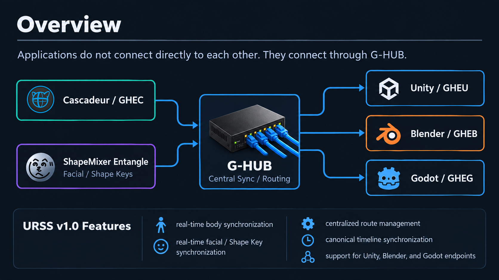
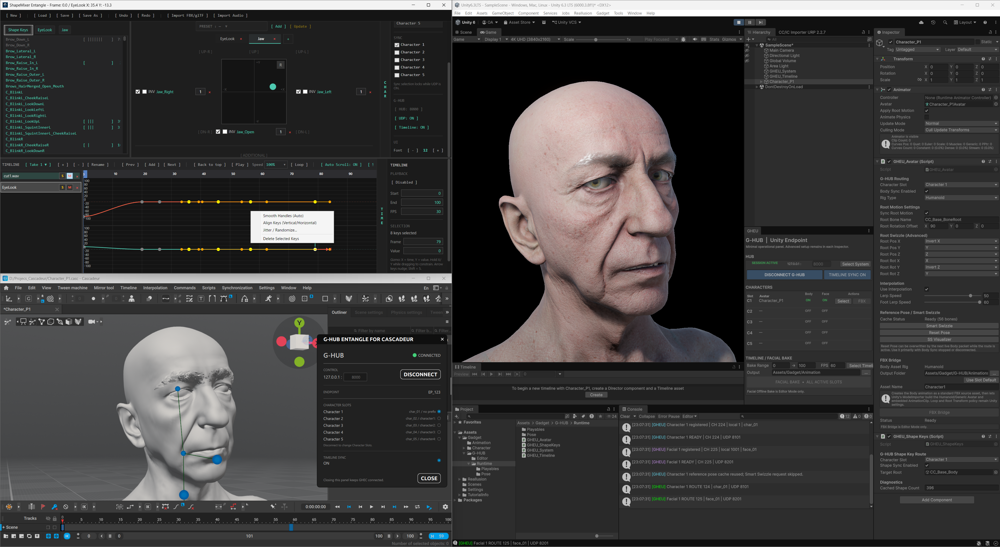
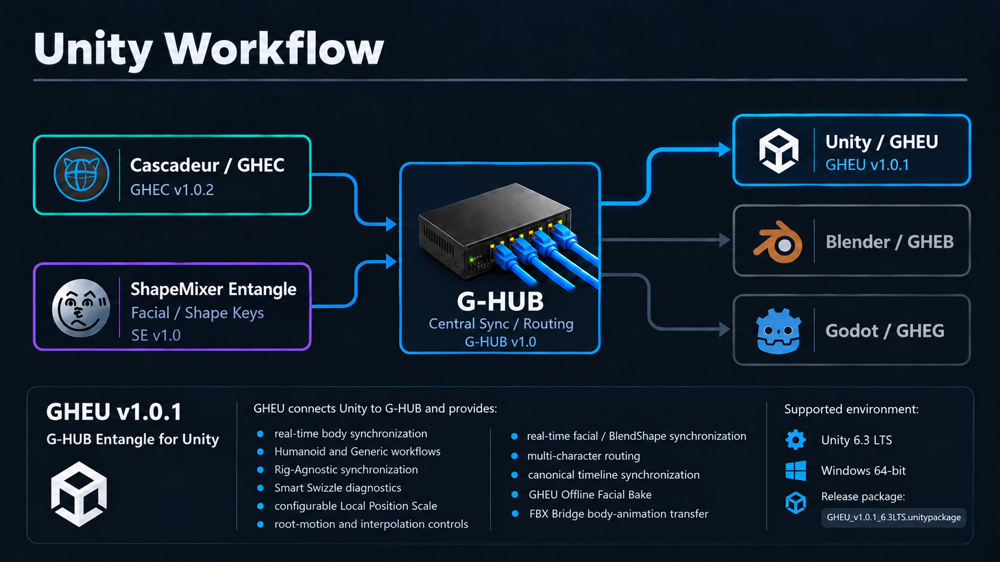
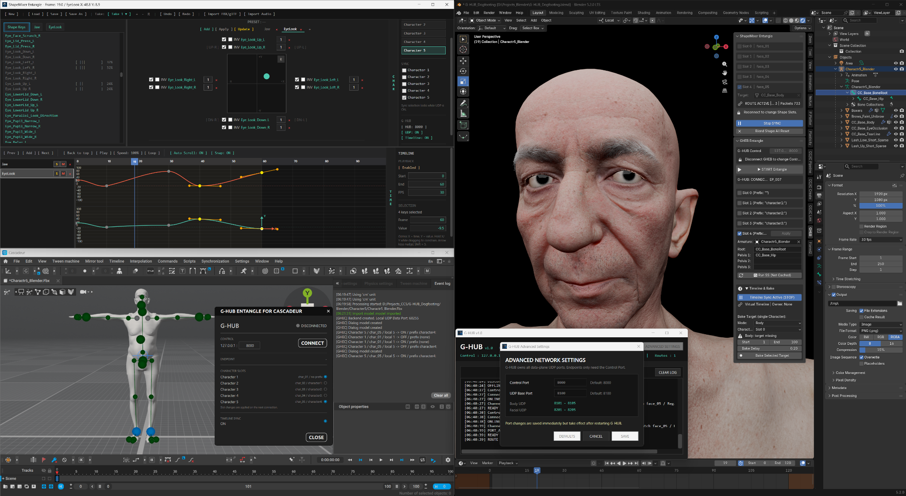
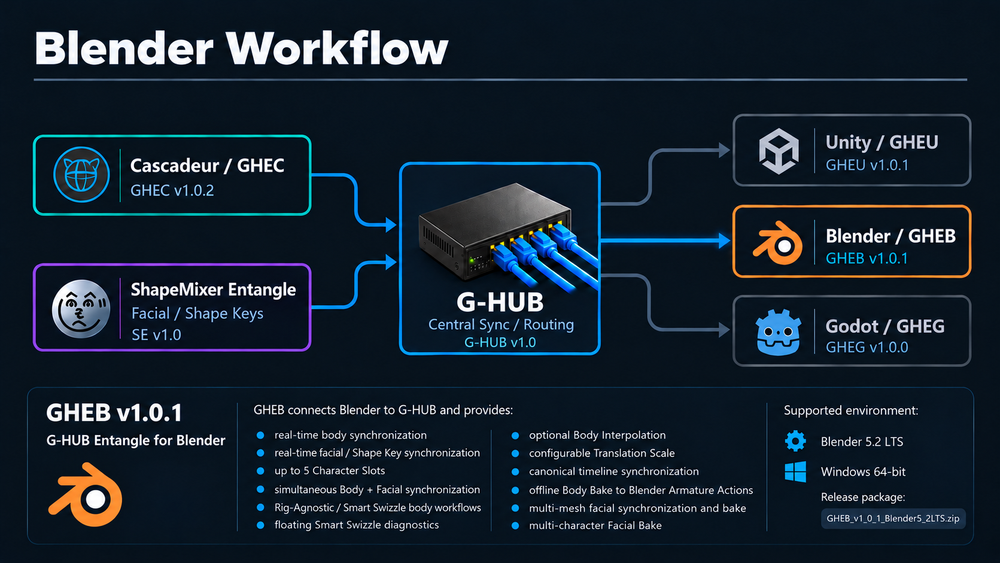
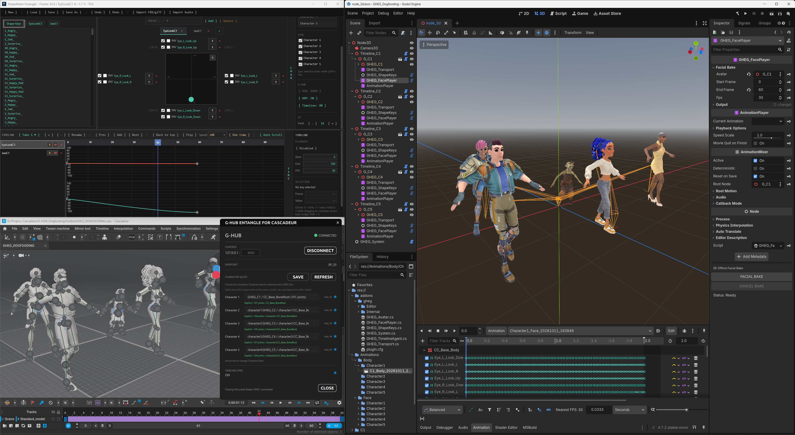
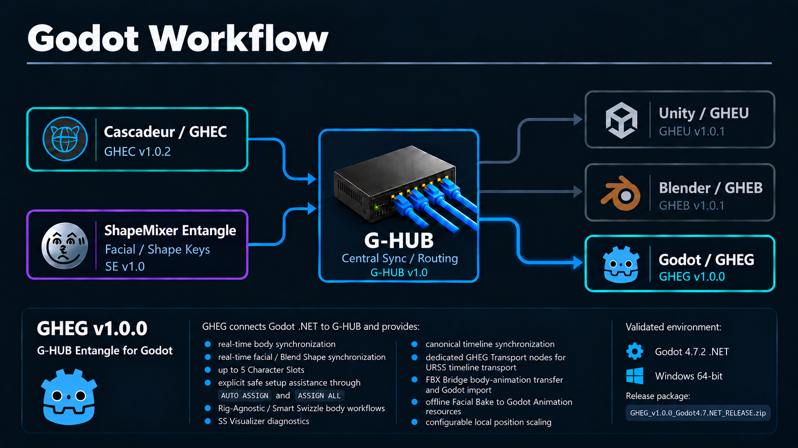

>## Downloads
>
>Official binary and packaged releases are available from [GitHub Releases](https://github.com/TeamGadget-JP/UNIVERSAL_REAL-TIME_SYNC_SYSTEM/releases).
>
>Current release tags use component-specific names. Please follow the instructions below for each software:
>
>## Standalone Applications (Unzip Required)
>*   **[G-HUB v1.0.0](https://github.com/TeamGadget-JP/UNIVERSAL_REAL-TIME_SYNC_SYSTEM/releases/download/g-hub-v1.0.0/G-HUB_v1.0_Windows_x64.zip)**  
>    Required for Universal Real-time Sync System.  
>    **How to install:** Unzip the file. This is a standalone application.
>*   **[ShapeMixerEntangle v1.0.0](https://github.com/TeamGadget-JP/UNIVERSAL_REAL-TIME_SYNC_SYSTEM/releases/download/se-v1.0.0/ShapeMixer_Entangle_v1.0_Windows_x64.zip)**  
>    Facial / Shape Key authoring Endpoint.  
>    **How to install:** Unzip the file. This is a standalone application.
>
>## Blender (⚠️ DO NOT UNZIP)
>*   **[GHEB v1.0.1](https://github.com/TeamGadget-JP/UNIVERSAL_REAL-TIME_SYNC_SYSTEM/releases/download/gheb-v1.0.1/GHEB_v1_0_1_Blender5_2LTS.zip)**  
>    Blender 5.2LTS Endpoint.  
>    **How to install:** ⚠️ **DO NOT UNZIP.** Download the `.zip` file and install it directly via Blender's Add-on / Extension preferences.
>
>## Game Engines & DCC Tools (Unzip Required)
>*   **[GHEC v1.0.2](https://github.com/TeamGadget-JP/UNIVERSAL_REAL-TIME_SYNC_SYSTEM/releases/download/ghec-v1.0.2/GHEC_v1.0.2_Windows_x64.zip)**  
>    Cascadeur 2026.2 Endpoint.  
>    **How to install:** Unzip the file and manually place the folder into the designated plugin directory.
>*   **[GHEU v1.0.1](https://github.com/TeamGadget-JP/UNIVERSAL_REAL-TIME_SYNC_SYSTEM/releases/download/gheu-v1.0.1/GHEU_v1.0.1_6.3LTS.unitypackage)**  
>    Unity 6.3LTS Endpoint.  
>    **How to install:** Unzip (if compressed) and install via standard `.unitypackage` import.
>*   **[GHEG v1.0.0](https://github.com/TeamGadget-JP/UNIVERSAL_REAL-TIME_SYNC_SYSTEM/releases/download/gheg-v1.0.0/GHEG_v1.0.0_Godot4.7.NET_RELEASE.zip)**  
>    Godot 4.7 .NET Endpoint.  
>    **How to install:** Unzip the file and manually place the folder into the designated plugin directory.



The current URSS suite provides:

- real-time body synchronization
- real-time facial / Shape Key synchronization
- up to **5 Character Slots**
- centralized route management
- canonical timeline synchronization
- Rig-Agnostic / Smart Swizzle workflows for supported body endpoints
- offline facial-animation bake for Unity, Blender, and Godot
- offline body-animation bake directly to Blender Actions
- FBX Bridge body-animation transfer workflows for Unity and Godot
- a dedicated facial-animation authoring environment through ShapeMixer Entangle

---

## Unity Workflow

Current Unity endpoint: **GHEU v1.0.1**

The Unity workflow combines:

- **Cascadeur + GHEC** for body animation
- **ShapeMixer Entangle** for facial / BlendShape animation
- **G-HUB** for routing and canonical synchronization
- **GHEU** as the Unity endpoint



For Unity production workflows:



Real-time body and facial synchronization can also run through the same G-HUB session.

For Offline Facial Bake, source and destination frame rates do not need to match. GHEU preserves canonical time and resolves each output frame against the corresponding SE source time.

---

## Blender Workflow

Current Blender endpoint: **GHEB v1.0.1**

The Blender workflow combines:

- **Cascadeur + GHEC** for body animation
- **ShapeMixer Entangle** for facial / Shape Key animation
- **G-HUB** for routing and canonical synchronization
- **GHEB** as the Blender endpoint



For Blender production workflows:



Real-time body and facial synchronization can run through the same GHEB endpoint.

For Offline Bake, source and destination frame rates do not need to match. GHEB preserves canonical time and resolves each Blender output frame against the corresponding routed source time.

---

## Godot Workflow

Current Godot endpoint: **GHEG v1.0.0**

The Godot workflow combines:

- **Cascadeur + GHEC** for body animation
- **ShapeMixer Entangle** for facial / Blend Shape animation
- **G-HUB** for routing and canonical synchronization
- **GHEG** as the Godot .NET endpoint



For Godot production workflows:



GHEG supports real-time body and facial synchronization, five Character Slots, canonical timeline synchronization, Smart Swizzle diagnostics, FBX Bridge import, and offline facial-animation bake.

The endpoint delivers body and facial animation assets into the Godot project. Final application of those assets to the production character scene remains a normal Godot authoring step controlled by the user.

---

## Components

| Component | Current Version | Role | Distribution |
| --- | --- | --- | --- |
| **G-HUB** | v1.0 | Central communication, routing, Character Slots, canonical timeline | Prebuilt Windows x64 application |
| **GHEC** | v1.0.2 | Cascadeur endpoint | Mixed distribution: source files + compiled protected backend |
| **GHEU** | v1.0.1 | Unity endpoint | Open source + Unity package |
| **ShapeMixer Entangle (SE)** | v1.0 | Facial / Shape Key authoring and synchronization | Prebuilt Windows x64 application |
| **GHEB** | v1.0.1 | Blender endpoint | Open-source Blender add-on |
| **GHEG** | v1.0.0 | Godot .NET endpoint | Source-distributed TeamGadget endpoint |

---

## Current Components

### G-HUB v1.0

**Universal Real-Time Sync Hub**

G-HUB is the center of the system.

It manages:

- endpoint registration
- Character Slot routing
- body and facial channels
- route creation and removal
- canonical timeline ownership and distribution
- configurable local network settings
- runtime channel / route monitoring

Documentation:

[`docs/g-hub/README.md`](docs/g-hub/README.md)

---

### GHEC v1.0.2

**G-HUB Entangle for Cascadeur**

GHEC connects Cascadeur to G-HUB and provides:

- real-time character streaming
- up to 5 Character Slots
- explicit Character assignment for `char_01` through `char_05`
- scene-owned Character Slot assignments
- Smart Swizzle / reference-pose exchange
- canonical timeline synchronization
- bridge workflows used by supported destination endpoints
- legacy prefix compatibility for older workflows

GHEC requires a supported paid Cascadeur license.

Release package:

```text
GHEC_v1.0.2_Windows_x64.zip
```

Documentation:

[`docs/ghec/README.md`](docs/ghec/README.md)

---

### GHEU v1.0.1

**G-HUB Entangle for Unity**

GHEU connects Unity to G-HUB and provides:

- real-time body synchronization
- Humanoid and Generic workflows
- Rig-Agnostic synchronization
- Smart Swizzle diagnostics
- configurable Local Position Scale
- root-motion and interpolation controls
- real-time facial / BlendShape synchronization
- multi-character routing
- canonical timeline synchronization
- GHEU Offline Facial Bake
- FBX Bridge body-animation transfer

Supported Unity version:

- **Unity 6.3 LTS**
- Windows 64-bit
- Release package: `GHEU_v1.0.1_6.3LTS.unitypackage`

GHEU is developed and validated specifically for Unity 6.3 LTS. Other Unity versions are not officially supported by this release.

Documentation:

[`docs/gheu/README.md`](docs/gheu/README.md)

---

### GHEB v1.0.1

**G-HUB Entangle for Blender**

GHEB connects Blender to G-HUB and provides:

- real-time body synchronization
- real-time facial / Shape Key synchronization
- up to 5 Character Slots
- simultaneous Body + Facial synchronization
- Rig-Agnostic / Smart Swizzle body workflows
- floating Smart Swizzle diagnostics
- optional Body Interpolation
- configurable Translation Scale
- canonical timeline synchronization
- offline Body Bake to Blender Armature Actions
- multi-mesh facial synchronization and bake
- multi-character Facial Bake

Supported Blender version:

- **Blender 5.2 LTS**
- Windows 64-bit
- Release package: `GHEB_v1_0_1_Blender5_2LTS.zip`

GHEB is developed and validated specifically for Blender 5.2 LTS. Other Blender versions are not officially supported by this release.

Documentation:

[`docs/gheb/README.md`](docs/gheb/README.md)

---

### GHEG v1.0.0

**G-HUB Entangle for Godot**

GHEG connects Godot .NET to G-HUB and provides:

- real-time body synchronization
- real-time facial / Blend Shape synchronization
- up to 5 Character Slots
- explicit safe setup assistance through `AUTO ASSIGN` and `ASSIGN ALL`
- Rig-Agnostic / Smart Swizzle body workflows
- SS Visualizer diagnostics
- canonical timeline synchronization
- dedicated GHEG Transport nodes for URSS timeline transport
- FBX Bridge body-animation transfer and Godot import
- offline Facial Bake to Godot Animation resources
- configurable local position scaling

Validated environment:

- **Godot 4.7.2 .NET**
- Windows 64-bit
- Release package: `GHEG_v1.0.0_Godot4.7.NET_RELEASE.zip`

GHEG setup requires several Godot-side nodes and references. The dedicated GHEG documentation includes a complete C1 step-by-step setup guide, fresh-project .NET initialization notes, node-structure guidance, and troubleshooting.

Documentation:

[`docs/gheg/README.md`](docs/gheg/README.md)

---

### ShapeMixer Entangle v1.0

**Facial / Shape Key Authoring Endpoint**

ShapeMixer Entangle is a dedicated facial-animation tool with:

- FBX / glTF Shape Key import
- layered XY pads
- additional Shape Key controls
- presets
- multi-Take animation
- Bezier curve editing
- audio waveform reference
- up to 5 Character Slots
- real-time G-HUB facial synchronization
- canonical timeline synchronization
- offline facial-bake workflows for supported endpoints

Documentation:

[`docs/se/README.md`](docs/se/README.md)

---

## Character Slots

The system supports up to **5 Character Slots**:

```text
C1 → char_01
C2 → char_02
C3 → char_03
C4 → char_04
C5 → char_05
```

Character Slots keep body, facial, bake, and timeline-related data separated between multiple characters.

The current routing contract treats the **URSS route / Character Slot as the character identity**. Bone and Joint names remain local to the character inside that route.

GHEC v1.0.2 introduced explicit Cascadeur Character assignment for this contract while retaining legacy prefix compatibility for older projects.

---

## Canonical Timeline Synchronization

G-HUB provides **full bidirectional timeline synchronization** between the current production endpoints:

- **Cascadeur / GHEC**
- **Unity / GHEU**
- **Blender / GHEB**
- **Godot / GHEG**
- **ShapeMixer Entangle / SE**

Any participating endpoint can drive the timeline, and the other connected endpoints follow the same canonical playback state through G-HUB.

Synchronized state includes:

- current time / frame position
- play
- pause
- stop
- scrub / seek
- playback range
- frame rate

### Time remains canonical across different FPS

The synchronization model preserves **time**, not merely identical frame numbers.

In other words:

> **1 second is always 1 second on every endpoint.**

If connected applications use different frame rates, each endpoint resolves the shared canonical time to its own local frame position.

For example:

```text
30 FPS endpoint → Frame 30 = 1.0 second
60 FPS endpoint → Frame 60 = 1.0 second
```

The visible frame numbers can therefore differ while the animation time remains synchronized.

This allows Cascadeur, Unity, Blender, Godot, and ShapeMixer Entangle to remain synchronized even when their local FPS settings differ.

Timeline synchronization is bidirectional: play, pause, stop, scrub / seek, range changes, and timeline position can be propagated through G-HUB so participating endpoints remain aligned.

---

## Design Principles

The suite is built around several core ideas.

### Centralized Routing

Endpoints communicate through G-HUB rather than implementing point-to-point integrations for every application pair.

### One Active Destination Route

URSS is designed around **Cascadeur + ShapeMixer Entangle ↔ one destination endpoint at a time**.

The system does not require simultaneous streaming to Unity, Blender, Godot, and other destination endpoints. This keeps route ownership and synchronization behavior deterministic.

### Character-Slot Isolation

Each character is assigned to a logical slot so body and facial data remain separated even when multiple characters are active.

### Rig-Agnostic Body Synchronization

Supported body endpoints exchange structure and reference-pose information so users do not need to create manual per-bone mappings for every compatible rig.

### Smart Swizzle

Smart Swizzle resolves reference-pose and local-axis differences between connected character structures while preserving each application's own rig conventions.

### Single-Target Offline Bake

Offline bake workflows are intentionally performed one target at a time. This keeps bake ownership explicit and favors reliability over batch complexity.

### Separate Body and Facial Production Paths

Where appropriate, body and facial animation use dedicated production workflows rather than forcing all data through one export mechanism.

For Unity:

- **Body asset:** FBX Bridge
- **Facial asset:** SE → G-HUB → GHEU Offline Facial Bake

For Blender:

- **Body asset:** GHEC → G-HUB → GHEB Offline Body Bake → Armature Action
- **Facial asset:** SE → G-HUB → GHEB Offline Facial Bake → Shape Key Action

For Godot:

- **Body asset:** FBX Bridge → Godot-imported animation
- **Facial asset:** SE → G-HUB → GHEG Offline Facial Bake → Godot Animation resource

---

## Repository Structure

```text
UNIVERSAL_REAL-TIME_SYNC_SYSTEM/
├─ README.md
└─ docs/
   ├─ images/
   │  ├─ unity_workflow.png
   │  ├─ blender_workflow.png
   │  └─ godot_workflow.png
   │
   ├─ g-hub/
   │  ├─ images/
   │  ├─ LICENSE.txt
   │  └─ README.md
   │
   ├─ ghec/
   │  ├─ images/
   │  ├─ EULA.md
   │  ├─ LICENSE
   │  └─ README.md
   │
   ├─ gheu/
   │  ├─ images/
   │  ├─ LICENSE
   │  └─ README.md
   │
   ├─ gheb/
   │  ├─ images/
   │  ├─ LICENSE
   │  └─ README.md
   │
   ├─ gheg/
   │  ├─ images/
   │  ├─ LICENSE.txt
   │  └─ README.md
   │
   └─ se/
      ├─ images/
      ├─ LICENSE
      └─ README.md
```

Component source and release assets are organized according to each component's distribution model.

---

## Licensing

Each component has its own license and distribution terms.

Please refer to the `LICENSE`, `LICENSE.txt`, or `EULA.md` included with the relevant component.

In general:

- **G-HUB** — proprietary TeamGadget binary distribution
- **ShapeMixer Entangle** — proprietary TeamGadget binary distribution
- **GHEC** — mixed distribution; source files and compiled proprietary backend are licensed separately
- **GHEU** — open-source Unity endpoint
- **GHEB** — open-source Blender endpoint
- **GHEG** — source-distributed TeamGadget Godot endpoint under its own license terms

Third-party libraries and runtimes remain subject to their respective licenses and notices.

---

## Third-Party Notice

This repository contains independent **TeamGadget** projects designed to interoperate with third-party applications and file formats.

TeamGadget is not affiliated with, endorsed by, sponsored by, certified by, or officially supported by the developers or owners of Cascadeur, Unity, Blender, Godot, or other referenced third-party products unless explicitly stated otherwise.

All third-party product names and trademarks belong to their respective owners.

---

## Logo and Trademark Notice

The architecture diagrams and workflow illustrations in this README include logos and visual identifiers of third-party applications, including **Cascadeur, Unity, Blender, and Godot**.

These logos are used solely for identification and to illustrate the applications supported by the **Universal Real-Time Sync System (URSS)**.

All third-party logos, product names, and trademarks remain the property of their respective owners.

The inclusion of these logos does not imply any affiliation, endorsement, sponsorship, certification, or official support of TeamGadget or URSS by the respective trademark owners.

All diagrams and workflow illustrations are independently created for documentation and technical explanation purposes and do not represent official materials from the respective application developers.

**TeamGadget respects the intellectual property rights of all third-party developers and organizations.**

---

## Project

**TeamGadget**  
**Universal Real-Time Sync System**
