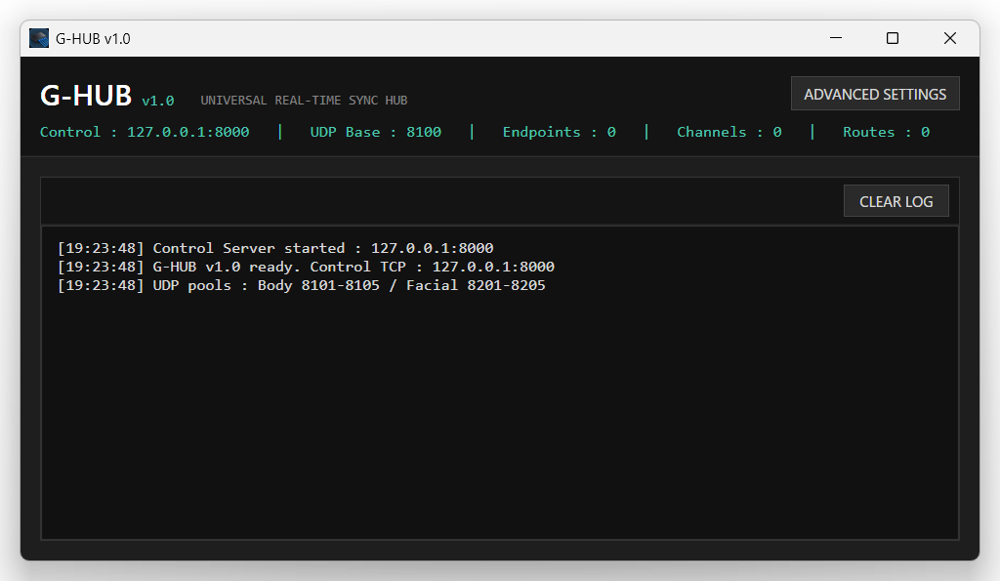
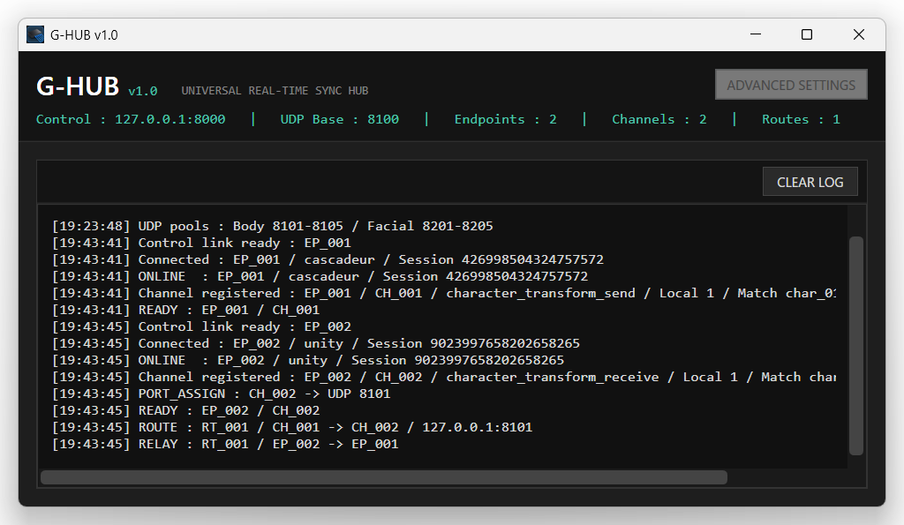
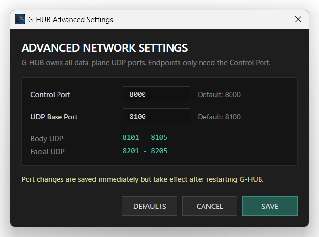

# G-HUB v1.0

**Universal Real-Time Sync Hub**

G-HUB는 **TeamGadget Universal Real-Time Sync System**의 중앙 통신 및 라우팅 컴포넌트입니다.

지원되는 TeamGadget 애플리케이션 간의 Endpoint 연결, Character Slot 라우팅, Body / Facial 데이터 라우팅, Canonical Timeline 동기화를 관리합니다.

> G-HUB는 일반적인 사용 시 최대한 단순하게 동작하도록 설계되었습니다. 실행하고 Endpoint를 연결하면, 나머지 라우팅은 Hub가 관리합니다.

---

## 개요

G-HUB는 TeamGadget 동기화 컴포넌트 사이에서 중앙 Hub 역할을 합니다.

각 컴포넌트는 서로 **직접 통신하지 않습니다**. 지원되는 각 컴포넌트는 G-HUB에 연결되고, G-HUB가 라우팅, Character Slot 할당, 동기화 상태를 관리합니다.

현재 TeamGadget 컴포넌트는 다음과 같습니다.

- **G-HUB Entangle for Cascadeur (GHEC)** — Cascadeur 측 동기화 컴포넌트
- **G-HUB Entangle for Unity (GHEU)** — Unity 동기화 컴포넌트
- **G-HUB Entangle for Blender (GHEB)** — Blender 동기화 컴포넌트
- **ShapeMixer Entangle (SE)** — Facial Animation 및 Shape Key 제작 도구

GHEC, GHEU, GHEB, ShapeMixer Entangle은 G-HUB를 통해 동작하도록 설계된 독립적인 TeamGadget 도구입니다.



---

## 기능

- 중앙 집중형 실시간 통신 Hub
- 동적 Endpoint 연결 관리
- 최대 **5 Character Slots**
- Body / Facial 데이터 라우팅
- Canonical Timeline 동기화
- 설정 가능한 Control Port
- 설정 가능한 UDP Base Port
- Slot별 Body / Facial UDP Port 자동 할당
- Runtime Route / Channel 상태 표시
- 내장 Event Log
- TeamGadget Entangle 컴포넌트용으로 설계

---

## 시스템 요구 사항

- **Windows 64-bit**
- G-HUB v1.0은 빌드된 Windows 애플리케이션으로 배포됩니다.
- 별도의 Installer는 필요하지 않습니다.

호환되는 TeamGadget 컴포넌트는 각각 별도로 배포됩니다.

---

## 설치

1. `G-HUB_v1.0_Windows_x64.zip`을 다운로드합니다.
2. ZIP 파일을 쓰기 가능한 임의의 폴더에 압축 해제합니다.
3. `GHub.exe`를 실행합니다.

별도의 설치 과정은 필요하지 않습니다.

> 압축을 해제한 폴더의 모든 파일은 함께 유지하십시오. `GHub.exe`만 단독으로 이동하지 마십시오.

---

## 빠른 시작

1. **G-HUB**를 실행합니다.
2. 사용할 TeamGadget 컴포넌트를 실행합니다.
3. 해당 컴포넌트가 G-HUB와 동일한 **Control Port**를 사용하도록 설정되어 있는지 확인합니다.
4. 컴포넌트를 G-HUB에 연결합니다.
5. 필요한 Character Slot을 활성화하거나 할당합니다.
6. 동기화를 시작합니다.

일반적인 사용 중에는 G-HUB에서 추가 설정이 거의 필요하지 않습니다.

---

## Main Window

G-HUB Main Window에는 현재 Network 및 Routing 상태가 표시됩니다.

컴포넌트가 연결되고 Route가 활성화되면 Header의 Counter가 자동으로 갱신됩니다.



### Control

TeamGadget 컴포넌트가 G-HUB에 연결할 때 사용하는 TCP Control Endpoint를 표시합니다.

기본값:

`127.0.0.1:8000`

기본 설정은 동일한 Windows PC 내의 Local Communication을 위한 것입니다.

### UDP Base

Character별 Body / Facial 데이터 Port를 계산하는 기준 UDP Port를 표시합니다.

기본값:

`8100`

기본 Body Port:

| Character Slot | Body UDP Port |
| --- | ---: |
| C1 | 8101 |
| C2 | 8102 |
| C3 | 8103 |
| C4 | 8104 |
| C5 | 8105 |

기본 Facial Port:

| Character Slot | Facial UDP Port |
| --- | ---: |
| C1 | 8201 |
| C2 | 8202 |
| C3 | 8203 |
| C4 | 8204 |
| C5 | 8205 |

### Endpoints

현재 연결된 TeamGadget 동기화 컴포넌트 수를 표시합니다.

예: GHEC, GHEU, GHEB, ShapeMixer Entangle.

### Channels

현재 G-HUB가 관리 중인 Active Data Channel 수를 표시합니다.

Channel은 연결된 컴포넌트와 Character Slot 상태에 따라 동적으로 생성되고 제거됩니다.

### Routes

현재 Active 상태인 Synchronization Route 수를 표시합니다.

Route는 호환되는 TeamGadget 컴포넌트 사이에서 G-HUB가 소유하는 Active Data Path를 의미합니다.

### Log

Log 영역에는 Connection, Channel, Route, Timeline, Relay Event가 표시됩니다.

표시 중인 Log 기록을 지우려면 **CLEAR LOG**를 사용하십시오.

Log를 지워도 Active Connection이나 동기화에는 영향을 주지 않습니다.

---

## Advanced Network Settings

Network 설정을 변경하려면 **ADVANCED SETTINGS**를 엽니다.



### Control Port

기본값:

`8000`

연결되는 모든 TeamGadget 컴포넌트는 동일한 G-HUB Control Port를 사용해야 합니다.

### UDP Base Port

기본값:

`8100`

G-HUB는 이 값을 기준으로 Character Slot별 Body / Facial UDP Port를 자동 계산합니다.

### Network Settings 변경

Active Endpoint, Channel 또는 Route가 존재하는 동안에는 Network 설정을 변경할 수 없습니다.

Network 설정을 변경하려면 Active 컴포넌트를 먼저 연결 해제하십시오.

Port 변경 사항은 **SAVE**를 누르면 저장되지만, 실제 적용은 G-HUB를 재시작한 후 이루어집니다.

- **DEFAULTS** — 기본 Control Port 및 UDP Base Port 값으로 복원합니다.
- **CANCEL** — 현재 편집 내용을 적용하지 않고 Dialog를 닫습니다.
- **SAVE** — 현재 값을 저장합니다.

변경된 Port를 저장한 후에는 컴포넌트를 다시 연결하기 전에 G-HUB를 재시작하십시오.

---

## Character Slots

G-HUB는 최대 **5 Character Slots**을 지원합니다.

- C1
- C2
- C3
- C4
- C5

Character Slot을 통해 여러 Character를 사용할 때 Body, Facial, Bake, Synchronization 데이터를 서로 분리할 수 있습니다.

Slot 할당은 연결된 TeamGadget 컴포넌트에서 제어합니다.

G-HUB는 Active Slot 설정에 따라 데이터를 라우팅합니다.

---

## Canonical Timeline Synchronization

G-HUB는 지원되는 TeamGadget 컴포넌트가 사용하는 중앙 Canonical Timeline 경로를 제공합니다.

현재 Active Timeline Owner가 Playback State를 G-HUB에 전달하면, 참여 중인 컴포넌트는 해당 Canonical Timeline State를 따릅니다.

연결된 컴포넌트에 따라 동기화되는 Timeline State에는 다음이 포함될 수 있습니다.

- Current Frame
- Play
- Pause
- Stop
- Scrub / Seek
- Timeline Range
- Frame Rate

Timeline 동기화는 선택 사항이며, 지원되는 TeamGadget 컴포넌트에서 활성화하거나 비활성화할 수 있습니다.

---

## Network Architecture

```text
Source-side components               Destination-side components
   ┌──────────────┐                         ┌─────────┐         
   │   Cascadeur  ├───── UDP Streaming ─────┤  Unity  │         
   │     GHEC     │                         │  GHEU   │         
   │              ├◄────── Handshake ──────►┤         │         
   └───────┬──────┘            ▲            └─────────┘         
           │                   │                 ▲              
           │             ┌─────┴─────┐           │              
           └────────────►┤           ├───────────┘              
                         │   G-HUB   │                          
           ┌────────────►┤           ├───────────┐              
           │             └─────┬─────┘           │              
           │                   │                 ▼              
   ┌───────┴──────┐            ▼            ┌─────────┐         
   │ ShapeMixer   ├◄────── Handshake ──────►┤ Blender │         
   │     Entangle │                         │  GHEB   │         
   │     (SE)     ├───── UDP Streaming ─────┤         │         
   └──────────────┘                         └─────────┘                           
```
실시간 Body / Facial 데이터는 G-HUB를 통해 라우팅됩니다. Control 및 Canonical Timeline 동기화는 연결된 컴포넌트에 따라 양방향으로 동작할 수 있습니다.

**중요:** 연결된 애플리케이션은 서로 직접 통신하지 않습니다. G-HUB가 중앙 Routing 및 Synchronization Owner입니다.

---

## 문제 해결

### 컴포넌트가 연결되지 않는 경우

다음을 확인하십시오.

- G-HUB가 실행 중인지
- 컴포넌트가 G-HUB와 동일한 Control Port를 사용하는지
- 설정된 Port를 다른 애플리케이션이 이미 사용 중인지
- Windows Firewall 또는 보안 소프트웨어가 Local Communication을 차단하고 있지 않은지

### Character가 데이터를 받지 못하는 경우

다음을 확인하십시오.

- 컴포넌트가 G-HUB에 연결되어 있는지
- 대상 Character Slot이 활성화되어 있는지
- 송신 및 수신 애플리케이션이 동일한 Character Slot을 사용 중인지
- G-HUB에서 Route가 Active 상태인지

### Timeline이 따라오지 않는 경우

다음을 확인하십시오.

- 참여 컴포넌트에서 Timeline Sync가 활성화되어 있는지
- 컴포넌트가 G-HUB에 연결되어 있는지
- 다른 참여 컴포넌트가 현재 Canonical Timeline Owner 역할을 하고 있는지

### Network 설정을 편집할 수 없는 경우

Active 컴포넌트를 먼저 연결 해제하십시오.

G-HUB는 Endpoint, Channel 또는 Route가 Active 상태인 동안 의도적으로 Network 설정을 잠급니다.

---

## 배포

G-HUB는 **빌드된 Windows 64-bit 애플리케이션**으로 배포됩니다.

Public Release에는 Source Code가 포함되지 않습니다.

다른 TeamGadget 동기화 컴포넌트는 각각 별도로 배포됩니다.

---

## License

G-HUB는 포함된 License 조건에 따라 개인 및 상업용 Animation Production에 무료로 사용할 수 있습니다.

전체 조건과 제한 사항은 `LICENSE.txt`를 확인하십시오.

---

## Third-Party Notice

이 프로젝트는 독립적인 **TeamGadget** 프로젝트입니다.

TeamGadget은 명시적으로 별도 표기되지 않는 한, 본 프로젝트에서 언급되는 Third-party Application의 개발자 또는 소유자와 제휴, 승인, 후원, 인증 또는 공식 지원 관계에 있지 않습니다.

모든 Third-party Product 이름과 Trademark는 각 권리자에게 귀속됩니다.

---

## Project

**TeamGadget**  
**G-HUB v1.0 — Universal Real-Time Sync Hub**
