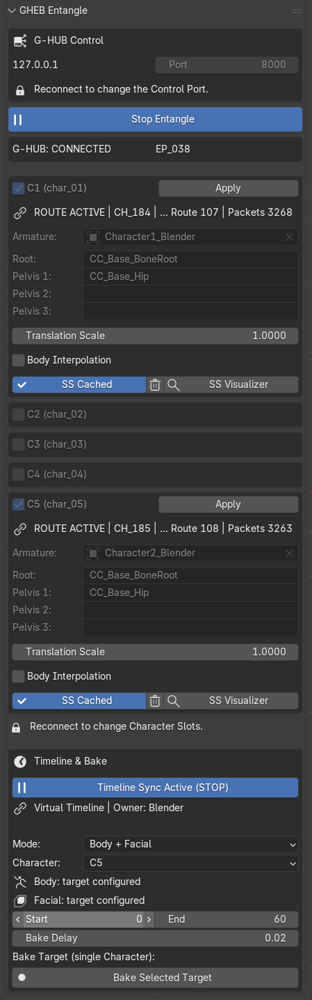
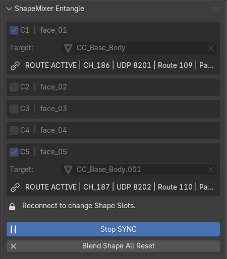

# GHEB v1.0.1 — G-HUB Entangle for Blender

**G-HUB Entangle for Blender (GHEB)**는 G-HUB를 통해 Blender와 함께 사용하도록 설계된 독립적인 TeamGadget 동기화 컴포넌트입니다.

GHEB는 Blender를 **TeamGadget Universal Real-Time Sync System**에 연결하고, 실시간 Body 동기화, 실시간 Facial / Shape Key 동기화, Multi-Character Routing, Canonical Timeline 동기화, Smart Swizzle 진단, 선택적 Body Interpolation, Blender Action으로 직접 기록하는 Offline Animation Bake를 제공합니다.

> GHEB는 Body, Facial, Timeline, Offline Bake Workflow 전체에서 하나의 공유 Blender Endpoint와 하나의 G-HUB Control Connection을 사용합니다.

---

## 개요

GHEB는 TeamGadget 동기화 시스템의 Blender 측 Endpoint입니다.

GHEB는 Cascadeur 또는 ShapeMixer Entangle과 **직접 통신하지 않습니다**.  
모든 Routing, Character Slot Matching, Canonical Synchronization은 **G-HUB**를 통해 처리됩니다.

```text
Cascadeur / GHEC
       │
       ▼
     G-HUB
       │
       ▼
Blender / GHEB
```

```text
ShapeMixer Entangle / SE
          │
          ▼
        G-HUB
          │
          ▼
    Blender / GHEB
```

Body와 Facial Synchronization은 동일한 GHEB Endpoint를 통해 동시에 실행할 수 있습니다.




## 기능

- G-HUB를 통한 실시간 Body 동기화
- G-HUB를 통한 실시간 Facial / Shape Key 동기화
- 최대 **5 Character Slots**
- C1–C5 독립 Body / Facial Routing
- Body + Facial 동시 Live Synchronization
- 호환 Character Structure용 Rig-Agnostic Body Synchronization
- Smart Swizzle Reference-pose Mapping
- Blender Scene에 저장되는 Persistent Smart Swizzle Cache
- Floating **SS Visualizer** Diagnostic Window
- Bone별 Search / Filter / Select / Frame / Copy Diagnostic Tool
- 선택 Bone 3D Diagnostic Axis
- Whole-character Diagnostic Marker 및 Resolved-target Axis
- Character별 선택적 Body Interpolation
- Canonical G-HUB Timeline Synchronization
- Blender Armature Action으로 Offline Body Bake
- Blender Shape Key Action으로 Offline Facial Bake
- Body + Facial을 별도 Action으로 Bake
- Multi-mesh Facial Synchronization 및 Bake
- 모든 Active Face Slot 대상 Multi-character Facial Bake
- Canonical Time 기반 Mixed-FPS Offline Bake
- 설정 가능한 G-HUB Control Port
- Non-destructive Live Synchronization Workflow

---

## 개발 / 검증 환경

GHEB v1.0.1은 다음 환경을 기준으로 개발 및 검증되었습니다.

- **Blender 5.2 LTS**
- Windows 64-bit

v1.0.1 Workflow에서 함께 사용하는 TeamGadget 컴포넌트:

- **G-HUB v1.0**
- **GHEC v1.0.2**
- **ShapeMixer Entangle v1.0**

> GHEB v1.0.1은 Blender 5.2 LTS만 공식 지원합니다. 다른 Blender Version은 이 Release의 공식 지원 대상이 아닙니다.

---

## 배포

권장 Release Package 이름:

```text
GHEB_v1_0_1_Blender5_2LTS.zip
```

Release ZIP에는 다음 Python Add-on Package Folder가 포함됩니다.

```text
GHEB_v1_0
```

수동으로 설치하거나 복사할 때 내부 Add-on Folder 이름을 변경하지 마십시오.

Blender는 Add-on을 Python Package로 로드하므로 내부 Folder 이름은 유효한 Python Module 이름을 유지해야 합니다.

---

# 설치

## 1. GHEB Add-on 설치

1. 다음 파일을 다운로드합니다.

```text
GHEB_v1_0_1_Blender5_2LTS.zip
```

2. **Blender 5.2 LTS**를 실행합니다.

3. Blender **Preferences**를 열고 Release ZIP에서 GHEB Add-on을 설치합니다.

4. 다음 Add-on을 활성화합니다.

```text
G-HUB Entangle for Blender (GHEB)
```

Add-on은 3D View Sidebar의 다음 Tab에 나타납니다.

```text
GHEB
```

> ZIP 대신 압축을 푼 Folder에서 설치하는 경우에도 Package Folder 이름은 배포된 그대로 `GHEB_v1_0`을 유지하십시오.

---

## 2. GHEB Sidebar 열기

Blender 3D View에서 Sidebar를 열고 다음 Tab을 선택합니다.

```text
GHEB
```

Sidebar에는 다음 Panel이 있습니다.

- **ShapeMixer Entangle**
- **GHEB Entangle**
- **Timeline & Bake**

---

# Character Setup 요구 사항

Body Synchronization을 시작하기 전에 Cascadeur와 Blender 양쪽에 호환되는 Character Version을 준비하십시오.

## 1. 호환 가능한 Character Structure 사용

GHEB는 Active Character Route에서 요청된 Structure를 기준으로 Blender Bone을 해석합니다.

최상의 결과를 위해 Cascadeur와 Blender Character는 다음 항목이 서로 대응되어야 합니다.

- Bone Hierarchy
- Bone Name
- Semantic Bone Role
- Reference Pose

GHEB는 호환 가능한 Character Structure가 존재하는 경우 사용자가 Bone별 Mapping을 직접 작성하지 않아도 되도록 설계되었습니다.

---

## 2. 일치하는 Reference Pose 사용

Smart Swizzle을 초기화하기 전에 Source와 Destination Character를 서로 호환되는 Reference Pose에 배치하십시오.

일반적으로 다음 Pose를 사용할 수 있습니다.

- T-pose
- A-pose

Smart Swizzle은 Reference Pose 관계를 사용하여 Cascadeur와 Blender 사이의 Local-axis 차이를 해결합니다.

---

## 3. GHEB는 Humanoid Rig Type에 제한되지 않습니다

GHEB는 Blender Armature와 직접 동작하며 Unity 방식의 Humanoid Avatar를 요구하지 않습니다.

Source와 Destination Character Structure가 적절히 일치한다면 Non-humanoid 또는 Custom Bone-driven Character도 동기화할 수 있습니다.

실제 호환성은 양쪽 Application에서 제공되는 Hierarchy, Bone Identity, Reference Pose, Transform Structure에 따라 달라집니다.

---

# 빠른 시작 — Body Synchronization

1. **G-HUB**를 실행합니다.
2. **Cascadeur**를 실행하고 **GHEC**를 연결합니다.
3. Destination Character가 포함된 Blender Project를 엽니다.
4. **GHEB** Sidebar를 엽니다.
5. **GHEB Entangle**에서 필요한 Character Slot을 활성화합니다.
6. Destination **Armature**를 할당합니다.
7. 필요하면 **Root / Pelvis** Translation Bone을 설정합니다.
8. 기존 기본 동작을 유지하려면 **Translation Scale**을 `1.0`으로 두고, Position Motion에 다른 배율이 필요하면 값을 조정합니다.
9. **Start Entangle**을 누릅니다.
10. 대응되는 G-HUB Body Route가 Active 상태가 될 때까지 기다립니다.
11. Cache가 아직 없다면 **Smart Swizzle**을 실행합니다.
12. 더 부드러운 Live Motion이 필요하면 **Body Interpolation**을 활성화합니다.
13. Canonical Timeline 동기화가 필요하면 **Sync Timeline**을 활성화합니다.

---

# ShapeMixer Entangle Panel

**ShapeMixer Entangle** Panel은 Blender 측 Facial / Shape Key 동기화를 설정합니다.

GHEB는 다음을 지원합니다.

```text
C1 | face_01
C2 | face_02
C3 | face_03
C4 | face_04
C5 | face_05
```

각 Face Slot은 독립적으로 다음 상태를 가집니다.

- Active State
- Target Mesh Anchor
- G-HUB Facial Channel
- G-HUB Route
- Live Shape Key State

---

## Target

선택한 **Target** Mesh는 Facial Synchronization을 위한 Character Anchor 역할을 합니다.

GHEB는 같은 Character Armature에 연결된 Shape Key Mesh를 검색하고, 하나의 Incoming ShapeMixer 값을 여러 Blender Mesh의 동일 이름 Shape Key에 적용할 수 있습니다.

다음과 같이 Facial Target이 여러 Mesh에 나뉜 Character에 유용합니다.

- Head
- Eyes
- Teeth
- Tongue
- Hair 또는 Accessory Facial Mesh

---

## Multi-Mesh Shape Key Matching

각 Incoming ShapeMixer Shape Name에 대해 GHEB는 Character에 참여하는 여러 Mesh에서 일치하는 Blender Shape Key를 찾습니다.

Matching은 다음을 지원합니다.

- 정확한 Shape Key Name
- Blender Shape Key Name의 마지막 `.` 뒤 Suffix Alias

이를 통해 Blender의 Duplicate-name Suffix를 그대로 유지하면서 ShapeMixer Source Name을 변경하지 않고 사용할 수 있습니다.

---

## Start SYNC / Stop SYNC

`Start SYNC`는 Active Face Slot을 활성화하고 대응하는 G-HUB Facial Route에 참여합니다.

Facial Synchronization이 Active인 동안 Face Slot 설정은 잠깁니다.

Active Face Slot이나 Target Mesh를 변경하기 전에 Synchronization을 중지하십시오.

---

## Blend Shape All Reset

`Blend Shape All Reset`은 Active Facial Character에 참여하는 Shape Key 값을 초기화합니다.

Reset은 GHEB가 해석한 Multi-mesh Character Set 전체에 적용됩니다.

---

# GHEB Entangle Panel

**GHEB Entangle** Panel은 공유 Blender Endpoint와 Body Synchronization을 제어합니다.

---

## G-HUB Control

기본 Endpoint:

```text
127.0.0.1:8000
```

Host는 Local입니다.

```text
127.0.0.1
```

**Port** Field는 G-HUB TCP Control Port를 설정합니다.

기본값:

```text
8000
```

GHEB Control Port는 G-HUB에 설정된 Control Port와 일치해야 합니다.

공유 GHEB Endpoint가 Active인 동안 Port는 잠깁니다.  
변경하려면 GHEB를 Stop / Reconnect하십시오.

---

## Start Entangle / Stop Entangle

`Start Entangle`은 공유 Blender Endpoint를 시작하고 Active Body Route에 참여합니다.

`Stop Entangle`은 다른 GHEB 기능에서 더 이상 필요하지 않을 때 공유 Endpoint 연결을 종료합니다.

Body, Facial, Timeline 기능은 하나의 GHEB Endpoint와 하나의 G-HUB Control Connection을 공유합니다.

---

# Character Slots

GHEB는 최대 **5 Character Slots**을 지원합니다.

| GHEB Slot | URSS Route |
| --- | --- |
| C1 | `char_01` |
| C2 | `char_02` |
| C3 | `char_03` |
| C4 | `char_04` |
| C5 | `char_05` |

GHEB v1.0.1은 현재 URSS Explicit Character Routing Contract를 따릅니다.

Character Identity는 Active URSS Route / Slot이 소유합니다. 따라서 GHEB는 원래 Bone Name을 요청하며 `character1:`, `character2:` 같은 Legacy Cascadeur Prefix에 의존하지 않습니다.

GHEB UI에서는 Route를 직접 표시합니다.

```text
C1 (char_01)
C2 (char_02)
...
C5 (char_05)
```

새 Blender Scene에서는 C1이 기본적으로 활성화되어 있습니다.

---

## Armature

Character Slot의 Body Route를 받을 Blender Armature를 할당합니다.

각 Active Character Slot은 독립적인 Body Route와 Runtime State를 가집니다.

---

## Root / Pelvis Translation Bones

다음 Field:

- Root
- Pelvis 1
- Pelvis 2
- Pelvis 3

는 Rotation과 함께 Translation Channel도 받아야 하는 Body Bone을 지정합니다.

Mapped Body Bone은 Live Rotation Data를 받습니다.  
설정된 Root / Pelvis Bone은 Position Sample이 존재하는 경우 Live Position Data도 받을 수 있습니다.

---

## Translation Scale

각 Character Slot에는 `Translation Scale` 설정이 있습니다.

기본값:

```text
1.0
```

이 Scale은 GHEB가 Incoming Coordinate Conversion을 처리한 뒤 Positional Translation에만 적용됩니다.

다음 설정 Bone의 Translation에 영향을 줍니다.

- Root
- Pelvis 1
- Pelvis 2
- Pelvis 3

동일한 배율이 **Live Sync**와 **Offline Body Bake** 모두에 사용되므로, Preview Motion과 Baked Action의 Positional Scale이 일치합니다.

Rotation에는 영향을 주지 않습니다.

예:

- `1.0` — 기존 기본 동작
- `0.5` — Translation 양을 절반으로
- `2.0` — Translation 양을 두 배로

> Smart Swizzle Cache Data는 Unit-neutral 상태를 유지합니다. `Translation Scale`은 Slot별 Output Multiplier이며 Smart Swizzle Cache를 다시 만들지 않고도 조정할 수 있습니다.

---

## Apply

`Apply`는 현재 Blender Frame에 현재 Live Body Pose의 Keyframe을 삽입합니다.

이는 명시적인 사용자 동작입니다.

GHEB를 중지해도 Live Synchronization Data가 Character Animation에 자동으로 기록되지는 않습니다.

---

# Body Interpolation

Incoming Live Body Motion은 Character Slot별로 선택적으로 Smoothing할 수 있습니다.

Body Interpolation은 기본적으로 **OFF**입니다.

활성화 시 GHEB는 다음을 사용합니다.

- Blender `Vector.lerp`를 이용한 Position Interpolation
- Blender `Quaternion.slerp`를 이용한 Rotation Interpolation

---

## Lerp Speed

기본값:

```text
12.0
```

낮은 값은 최신 Live Pose에 더 부드럽고 천천히 수렴합니다.

높은 값은 Source를 더 직접적으로 따라갑니다.

Body Interpolation은 Live Body Synchronization에만 영향을 줍니다.  
Offline Bake는 Authoritative Sampled Source Data를 기준으로 유지됩니다.

---

# Reference Pose / Smart Swizzle

GHEB는 Rig-Agnostic Body Synchronization을 위해 Cached Reference-pose Workflow를 사용합니다.

Smart Swizzle이 초기화되면 GHEB는 Blender Character Reference Pose와 G-HUB를 통해 수신한 대응 Cascadeur Reference-pose Data를 비교합니다.

생성된 Cache는 Blender Scene에 저장되며 이후 호환되는 연결에서 다시 사용할 수 있습니다.

---

## SS Cached

`SS Cached`는 해당 Character Slot에 Smart Swizzle Reference Data가 존재함을 의미합니다.

Character Structure 또는 Reference Pose가 변경되었다면 옆의 Delete Control을 사용해 Cache를 삭제하십시오.

---

## Run Smart Swizzle

Cache가 없는 경우 Body Route가 Active가 된 뒤 다음을 실행합니다.

```text
Run Smart Swizzle
```

GHEB는 대응 Cascadeur Reference Data를 요청하고 Blender 측 Mapping Cache를 생성합니다.

---

## SS Visualizer

`SS Visualizer`는 선택한 Character Slot용 Floating Smart Swizzle Diagnostic Window를 엽니다.

Character가 정상적으로 동작하기 시작한 뒤에는 일반 Synchronization에 Visualizer가 필요하지 않습니다.

---

# Smart Swizzle Visualizer

**SS Visualizer**는 Smart Swizzle Pipeline 전체를 검사하기 위한 Floating Diagnostic Tool입니다.

다음 용도로 사용할 수 있습니다.

- 정상적으로 동기화되지 않는 Rig 진단
- Reference-pose Exchange 완료 여부 확인
- Bone별 Mapping 확인
- 누락된 Rest, Live, Target Data 식별
- Resolved Target과 실제 Blender Pose 비교

---

## Character Status

상단 영역에는 다음 정보가 표시됩니다.

- Route State
- Reference Cache State
- Mapped Bones
- Cascadeur Rest Count
- Live Samples Count
- Resolved Targets Count
- Diagnostic Issues / Pipeline Complete

정상적으로 완료된 Route에서는 Mapped Bones, Cascadeur Rest, Live Samples, Resolved Targets가 동일한 Count를 표시할 수 있습니다.

---

## Bone Browser

Bone Browser에는 다음 기능이 있습니다.

- Search
- Filter
- Bone Selection
- Bone ID
- Cascadeur Request Name
- Diagnostic State
- Select Bone
- Frame Bone
- Copy Diagnostic

Filter에는 다음과 같은 일반 / 문제 중심 View가 있습니다.

- All
- Issues
- Ready
- Missing Rest
- No Live
- No Target

`Copy Diagnostic`은 선택한 Bone Diagnostic Data를 Issue Report 또는 Technical Support용으로 복사합니다.

---

## Selected Bone 3D Diagnostics

선택한 Bone에 대해 Visualizer는 다음을 표시할 수 있습니다.

- Rest Axes
- Live Axes
- Target Axes
- Actual Axes

현재 Color:

| Diagnostic | Color |
| --- | --- |
| Rest | Gray |
| Live | Cyan |
| Target | Orange |
| Actual | Magenta |

`Axis Size`는 선택 Bone의 Axis Visualization Scale을 조절합니다.

---

## Whole-Character Diagnostics

Visualizer는 다음도 표시할 수 있습니다.

- **All Bone Status Markers**
- **All Resolved Target Axes**
- 설정 가능한 **Marker Size**

Status Marker Color:

| State | Color |
| --- | --- |
| Ready | Green |
| Missing Rest | Orange-Red |
| No Live | Yellow |
| No Target | Red |
| Currently inspected Bone | White |

Whole-character Diagnostics를 사용하면 Bone을 하나씩 확인하지 않고도 Rig 위에서 Mapping 문제 위치를 직접 찾을 수 있습니다.

---

## Selected Bone Pipeline

하단 Diagnostic 영역에는 다음 항목이 표시될 수 있습니다.

- Cascadeur Rest State
- Cascadeur Live State
- Blender Target State
- Rest Position
- Rest Quaternion
- Resolved Live Rotation
- Resolved Live Position
- Actual Local Rotation
- Actual Local Position

Body Interpolation이 OFF일 때는 Resolved Target과 실제 Blender Pose가 보통 매우 가깝게 수렴합니다.

Body Interpolation이 ON일 때는 Smoothing 중 실제 Blender Pose가 최신 Resolved Live Target보다 의도적으로 늦게 따라올 수 있습니다.

---

# Timeline & Bake

**Timeline & Bake** 영역은 Canonical Timeline 참여 및 Offline Bake 기능을 제공합니다.

Timeline Synchronization과 Offline Bake는 독립 기능이지만 동일한 공유 GHEB Endpoint를 사용합니다.

---

# Canonical Timeline Synchronization

다음을 사용합니다.

```text
Sync Timeline
```

G-HUB Canonical Timeline에 참여합니다.

GHEB는 다음을 수행할 수 있습니다.

- Blender에서 Canonical Timeline Drive
- Cascadeur / GHEC Follow
- ShapeMixer Entangle / SE Follow
- Canonical Time Scrub / Seek
- Play / Pause / Stop State Follow
- Local Frame Rate가 달라도 정확한 Synchronization

G-HUB가 Canonical Timeline State와 Ownership을 관리합니다.

다른 Endpoint가 Playback을 소유할 때 GHEB는 독립적인 경쟁 Playback Clock을 실행하지 않고 수신된 Canonical Position을 따라갑니다.  
이를 통해 느린 Remote Playback Rate를 따라갈 때 Forward / Backward Chatter가 발생하지 않습니다.

---

## Mixed FPS

GHEB는 동일한 Frame Number를 요구하지 않고 Canonical Time을 기준으로 동기화합니다.

예:

```text
30 FPS → Frame 30 = 1.0 second
60 FPS → Frame 60 = 1.0 second
```

표시되는 Frame Number가 달라도 Animation Time은 계속 일치합니다.

---

# Offline Bake

GHEB는 G-HUB를 통해 정확하게 Sample된 Animation Data를 요청하고 결과를 Blender Action으로 직접 기록할 수 있습니다.

사용 가능한 Bake Mode:

```text
Body
Facial
Body + Facial
```

---

## Body

Body Bake는 다음을 포함하는 Blender Armature Action을 생성합니다.

- Mapped Bone용 Quaternion Rotation Curve
- 설정된 Root / Pelvis Translation Bone용 Position Curve

생성되는 Action 이름 형식:

```text
GHEB_Body_<Armature>_<Start>_<End>
```

---

## Facial

Facial Bake는 Blender에 Shape Key Animation을 직접 생성합니다.

`Mode = Facial`일 때 GHEB는 C1부터 C5까지 **모든 Active / Valid Face Slot**을 순서대로 처리합니다.

각 Character는 독립적인 Facial Action을 받습니다.

Facial Action은 동일 Character에 속한 여러 Blender Shape Key Datablock에서 Matching Shape Key를 Drive할 수 있습니다.

생성되는 Action 이름 형식:

```text
GHEB_Face_<Target>_<Start>_<End>
```

---

## Body + Facial

`Body + Facial`은 선택한 Character를 두 개의 별도 Blender Action으로 Bake합니다.

- Armature Body Action 1개
- Facial Shape Key Action 1개

Body와 Facial 결과물은 서로 분리된 Production Asset으로 유지됩니다.

---

## Bake Target Behavior

현재 v1.0.1 동작:

- **Body** — 선택한 Character 1개
- **Facial** — 모든 Active / Valid Face Slot
- **Body + Facial** — 선택한 Character 1개

이를 통해 Multi-character Facial Bake는 편리하게 유지하면서 Body Transaction은 명확하고 예측 가능하게 유지합니다.

---

## Bake Range

다음 값을 설정하여 Blender Output Frame Range를 지정합니다.

- Start
- End

---

## Bake Delay

기본값:

```text
0.02
```

Bake Delay는 완료된 Offline Bake Frame Transaction 사이에 선택적 Pause를 추가합니다.

Advanced Use / Testing용으로 `0.00`도 사용할 수 있습니다.

v1.0.1에서는 기본값 `0.02`를 안전한 권장 설정으로 사용합니다.

---

## Mixed-FPS Offline Bake

Source와 Destination Frame Rate는 같을 필요가 없습니다.

각 Destination Blender Frame에 대해 GHEB는 해당 Frame을 Canonical Time으로 변환하고, Routed Endpoint에서 대응하는 Source Time을 요청합니다.

이를 통해 Cascadeur, ShapeMixer Entangle, Blender가 서로 다른 FPS를 사용해도 Animation Timing이 유지됩니다.

---

# Live State와 Blender File

Live Synchronization은 의도적으로 Non-destructive 방식입니다.

현재 Live Pose는 Runtime State이며 `.blend` File에 자동으로 기록되지 않습니다.

Blender를 종료한 뒤 `.blend` File을 다시 열면:

1. Character는 먼저 Blender File에 저장된 Pose로 표시됩니다.
2. GHEB를 Start / Reconnect합니다.
3. 현재 Live Source Pose가 다시 수신되어 적용됩니다.

Smart Swizzle Reference Data는 Blender Scene에 저장된 상태로 유지할 수 있지만, 현재 Live Stream Pose는 Persistent Animation Data로 취급되지 않습니다.

Animation Data를 Blender에 기록하려면 **Apply** 또는 **Offline Bake**를 사용하십시오.

---

# 문제 해결

## GHEB가 G-HUB에 연결되지 않는 경우

다음을 확인하십시오.

- G-HUB가 실행 중인지
- GHEB와 G-HUB가 동일한 Control Port를 사용하는지
- Blender 5.2 LTS를 사용 중인지
- Windows Firewall 또는 보안 소프트웨어가 Local Communication을 차단하지 않는지

---

## Body Route가 Inactive 상태로 유지되는 경우

다음을 확인하십시오.

- 대상 C1–C5 Character Slot이 활성화되어 있는지
- Target Armature가 할당되어 있는지
- GHEC가 G-HUB에 연결되어 있는지
- GHEC가 동일한 Character Slot을 사용하는지
- 대응 Body Route가 G-HUB에 존재하는지

Route는 Active인데 Pose가 잘못된 경우 **SS Visualizer**로 Character를 확인하십시오.

---

## Smart Swizzle Cache가 없는 경우

다음을 확인하십시오.

- Body Route가 Active인지
- Destination Armature가 할당되어 있는지
- Cascadeur와 Blender Character가 호환되는 Bone Name / Hierarchy를 사용하는지
- 두 Character가 호환되는 Reference Pose를 사용하는지

그 후 **Smart Swizzle**을 다시 실행하십시오.

---

## Facial Route는 Active인데 하나의 Mesh만 움직이는 경우

다음을 확인하십시오.

- 설정한 Target Mesh가 대상 Character에 속하는지
- 추가 Facial Mesh가 동일한 Character Armature로 해석되는지
- Shape Key가 일치하는 Name 또는 지원되는 Blender Suffix Alias를 사용하는지

GHEB Live Facial Synchronization은 Incoming Name이 일치하는 모든 Participating Character Mesh에 값을 전달하도록 설계되었습니다.

---

## 다른 Endpoint가 느린 Playback Rate를 사용할 때 Timeline이 떨리는 경우

GHEB v1.0.1은 External Canonical Playback을 Passive하게 따라갑니다.

이 현상이 나타나면 현재 v1.0.1 GHEB File이 설치되어 있고 오래된 Development Build가 아직 활성화되어 있지 않은지 확인하십시오.

---

## Offline Bake가 시작되지 않는 경우

다음을 확인하십시오.

- 필요한 Body 및/또는 Facial Route가 Active인지
- 선택한 Character가 Body Bake용으로 설정되어 있는지
- Active Face Slot에 Facial Bake용 Valid Target Mesh가 있는지
- Bake Start / End Range가 유효한지

---

## Blender 재실행 시 이전 Live Pose가 아니라 저장된 Pose로 열리는 경우

정상 동작입니다.

Live Pose Data는 Runtime Synchronization State이며 `.blend` File에 자동으로 저장되지 않습니다.

GHEB를 다시 연결하면 현재 Live Source Pose를 복원할 수 있으며, **Apply** / **Offline Bake**를 사용하면 Persistent Animation Data를 생성할 수 있습니다.

---

# Open Source

GHEB는 Open-source Blender Endpoint입니다.

적용되는 License 조건은 GHEB와 함께 배포되는 `LICENSE` File을 확인하십시오.

---

# Third-Party Notice

Blender는 Blender Foundation의 Trademark입니다.

Cascadeur는 Nekki의 Trademark입니다.

GHEB, G-HUB, GHEC, GHEU, ShapeMixer Entangle, TeamGadget Universal Real-Time Sync System은 독립적인 TeamGadget 프로젝트입니다.

명시적으로 달리 표기되지 않는 한 TeamGadget은 Blender Foundation, Nekki, Unity Technologies 또는 기타 언급된 Third-party Vendor와 제휴, 승인, 후원, 인증 또는 공식 지원 관계에 있지 않습니다.

모든 Third-party Product Name과 Trademark는 각 권리자에게 귀속됩니다.

---

# Project

**TeamGadget**  
**G-HUB Entangle for Blender (GHEB) v1.0.1**
