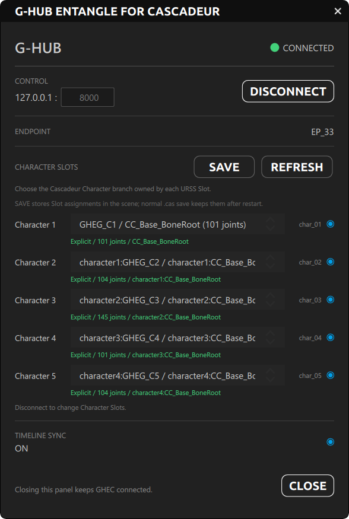
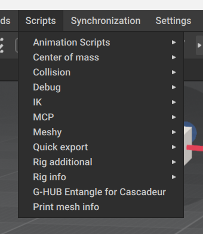

# GHEC v1.0.2 — G-HUB Entangle for Cascadeur

**G-HUB Entangle for Cascadeur (GHEC)** は、G-HUBを介してCascadeurと連携するための独立したTeamGadget同期コンポーネントです。

GHECはCascadeurを **TeamGadget Universal Real-Time Sync System** へ接続し、リアルタイムCharacter同期、Explicit Character Slot Assignment、Route単位のMulti-Character同期、Canonical Timeline同期を提供します。

> GHEC v1.0.2ではExplicit Character Assignmentを使用します。各URSS Character SlotをCascadeurのCharacter Branchへ直接割り当てるため、Character IdentityはBone名Prefixに依存しません。

---

## 概要

GHECはTeamGadget同期システムのCascadeur側コンポーネントです。

GHECはUnity、Blender、ShapeMixer Entangle、その他Applicationと**直接通信しません**。  
すべてのRoute / Synchronizationは **G-HUB** を介して処理されます。

```text
Cascadeur / GHEC
       │
       ▼
     G-HUB
      ├── GHEU — G-HUB Entangle for Unity
      ├── GHEB — G-HUB Entangle for Blender
      └── SE   — ShapeMixer Entangle
```



## 動作要件

### 検証環境

- **Cascadeur 2026.2.2**
- **Windows 64-bit**
- **G-HUB v1.0**

### Cascadeur License要件

GHECの利用にはCascadeur有料Licenseが必要です。

対応License Tier:

- Indie
- Pro
- Teams

Cascadeur無料版はGHECの対応対象外です。

---

## インストール

GHECはCascadeurのPython Script DirectoryとPython Model Directoryを使用します。

### 1. GHEC Scriptを導入

以下をコピーします。

```text
ghec.py
```

コピー先:

```text
<Cascadeur installation folder>/resources/scripts/python/scripts/
```

例:

```text
C:/Program Files/Cascadeur/resources/scripts/python/scripts/
```

### 2. GHEC Model Fileを導入

存在しない場合は、以下のFolderを作成します。

```text
<Cascadeur installation folder>/resources/scripts/python/models/ghec/
```

以下のFileをそのFolderへコピーします。

```text
backend.pyc
model.py
view.qml
```

最終構成は以下のようになります。

```text
resources/
└─ scripts/
   └─ python/
      ├─ scripts/
      │  └─ ghec.py
      │
      └─ models/
         └─ ghec/
            ├─ backend.pyc
            ├─ model.py
            └─ view.qml
```

### 3. GHECを起動

Fileを配置した後、Cascadeurを再起動します。

**Scripts** Menuから以下を選択します。

**G-HUB Entangle for Cascadeur**



> GHEC v1.0.2のDocumentationはCascadeur 2026.2.2を基準に記述されています。

---

## クイックスタート

1. **G-HUB**を起動します。
2. **Cascadeur**を起動します。
3. Cascadeurの**Scripts** Menuから **G-HUB Entangle for Cascadeur** を選択します。
4. GHEC起動後にSceneを変更した場合は、**REFRESH**を押して利用可能なCascadeur Character Branchを再Scanします。
5. 使用するURSS Character Slotごとに、Drop-downから対応するCascadeur Character Branchを選択します。
6. 必要なCharacter Slotを有効化します。
7. Slot Assignmentが未保存状態を示している場合は **SAVE** を押し、その後通常どおりCascadeur `.cas` Sceneを保存します。
8. G-HUB Control PortがG-HUBと一致していることを確認します。
9. **CONNECT**を押します。
10. Destination TeamGadget Endpointを接続し、同じCharacter Slotを使用します。
11. Canonical Timeline同期が必要な場合のみ **Timeline Sync** を有効化します。

GHECが接続されると、Statusは **CONNECTED** へ変わり、Endpoint IDが表示されます。DisconnectするまでCharacter Slot設定はLockされます。


> Character AssignmentはScene所有のStateです。`SAVE`はGHECが使用するSlot Assignmentを保存し、さらに`.cas` Sceneを保存することで再起動後もそのAssignmentを保持できます。

---

## G-HUB接続

GHECは設定されたControl Portを使用してG-HUB Control Planeへ接続します。

Default:

```text
127.0.0.1:8000
```

Default設定は、同一Windows PC上での通信を想定しています。

G-HUB側でControl Portを変更した場合は、接続前にGHEC側にも同じControl Portを設定してください。

---

## Character Slots

GHECは最大 **5 Character Slots** をサポートします。

| GHEC Slot | URSS Route |
| --- | --- |
| Character 1 | `char_01` |
| Character 2 | `char_02` |
| Character 3 | `char_03` |
| Character 4 | `char_04` |
| Character 5 | `char_05` |

### Explicit Character Assignment

GHEC v1.0.2では、有効な各URSS SlotをCascadeur Character Branchへ直接割り当てます。

選択したSlotが、そのCharacterのJoint Setを所有します。そのためDestination Endpointは、`character1:`、`character2:`などのNaming Prefixを追加せず、元のJoint名でCharacterをRequestできます。

基本手順:

1. 必要に応じて **REFRESH** を押し、Character Root Joint Branchを再Scanします。
2. Slot Drop-downから対象Cascadeur Characterを選択します。
3. Slotを有効化します。
4. Assignmentが未保存表示の場合は **SAVE** を押します。
5. `.cas` Sceneを保存します。
6. GHECを接続します。

Assignment行には、所有Joint数や選択Branch名を含む現在状態が表示されます。

### Legacy Compatibility

旧Prefix方式のLookupは、v1.0.2以前のWorkflowとの互換性のためだけに保持されています。新規Workflowでは推奨されません。

新しいEndpoint実装では、URSS Route / Character SlotをCharacter Identityとして扱い、そのRoute内では元のBone / Joint名を使用してください。

> Character Slot AssignmentおよびEnable / DisableはDisconnect中のみ編集できます。変更前にGHECをDisconnectしてください。

---

## Character同期

GHECはLive Streaming開始前にInitialization / Handshake Stageを使用します。

接続時、同期に必要なCharacter StructureをG-HUB経由で交換します。

Routeの準備が完了すると、Live Character Dataは割り当てられたG-HUB UDP Channelを通してStreamingされます。

### Rig-Agnostic Workflow

TeamGadget同期Architectureは、両側に互換Character Structureが存在する場合、ユーザーがBone Mappingを手作業で作成しなくてもよいように設計されています。

接続ApplicationはInitialization時にCharacter Structureを提供し、Destination ComponentがLocal Mappingを内部で解決します。

これにより、CC専用またはHumanoid専用の固定Pipelineを要求せず、異なるRig Typeでも同じ同期Workflowを利用できます。

実際の互換性は、接続Applicationで利用可能なHierarchy / Character Dataに依存します。

---

## Timeline同期

GHECはG-HUB Canonical Timeline同期へ参加できます。

**Timeline Sync**を有効にすると、CascadeurはG-HUBを介して参加TeamGadget ComponentとTimeline Stateを交換できます。

接続Componentに応じて、同期対象には以下を含められます。

- Current Frame
- Play
- Pause
- Stop
- Scrub / Seek
- Timeline Range
- Frame Rate

Timeline同期は任意です。

---

## User Interface

GHEC Windowには通常運用に必要なControlがまとまっています。

### G-HUB

現在のG-HUB接続状態を表示します。

- **Control** — G-HUB Control Address / Port
- **CONNECT / DISCONNECT** — GHECとG-HUBを接続・切断
- **Connection Status** — GHECの接続状態を表示

### Character Slots

Character 1～Character 5を表示します。

各Rowには以下があります。

- Cascadeur Character Branch Selector
- URSS Route Identifier (`char_01` ～ `char_05`)
- Enable / Disable Control
- 現在のAssignment State

Character Slots Sectionにはさらに以下があります。

- **REFRESH** — 利用可能なCascadeur Character Root Joint Branchを再Scan
- **SAVE** — 通常の`.cas` Scene保存前に変更済みSlot Assignmentを保存

Explicit Character Assignmentがv1.0.2の標準Workflowです。Legacy Prefix Fallbackは旧Project / Endpoint向け互換目的のみで保持されています。

### Timeline Sync

G-HUB Canonical Timeline同期への参加を制御します。

有効時、GHECはG-HUBを介して他の参加TeamGadget ComponentとTimeline Stateを交換できます。

### Close

GHEC Windowを閉じます。

Panelを閉じてもGHECは**Disconnectされません**。すでに接続済みの場合、明示的にDisconnectするまで接続は維持されます。

---

## 配布

推奨v1.0.2 Release Archive:

```text
GHEC_v1.0.2_Windows_x64.zip
```

GHECは混合Distribution Modelを使用します。

### Open-Source Components

以下はSourceとして配布されます。

```text
ghec.py
model.py
view.qml
```

### Compiled Backend

以下はCompiled Formのみで配布されます。

```text
backend.pyc
```

`backend.pyc`には、GHECで使用するCascadeur License Validationを含む保護されたBackend機能が含まれます。

Compiled Backendは、GHECのOpen-source部分には含まれません。

---

## トラブルシューティング

### CascadeurにGHECが表示されない

以下を確認してください。

- `ghec.py` がCascadeur Python `scripts` Directoryに配置されている
- `backend.pyc`、`model.py`、`view.qml` が `models/ghec` に配置されている
- 導入後にCascadeurを再起動した
- **Scripts** Menuから **G-HUB Entangle for Cascadeur** を起動している

### GHECがG-HUBへ接続できない

以下を確認してください。

- G-HUBが起動している
- GHECとG-HUBが同じControl Portを使用している
- 設定Portを別Applicationが使用していない
- Windows Firewall / Security SoftwareがLocal通信をBlockしていない

### Character Slotが同期しない

以下を確認してください。

- GHEC側でCharacter Slotが有効
- 対応Destination ComponentがG-HUBへ接続済み
- 両Applicationが対応するCharacter Slotを使用している
- G-HUB上でRouteがActive

### Timeline Syncが動作しない

以下を確認してください。

- GHECがG-HUBへ接続済み
- Timeline Syncが有効
- 他の参加TeamGadget ComponentがCanonical Timeline Pathへ接続済み

---

## ライセンス

GHECはOpen-source部分とCompiled Componentで別々のLicenseを使用します。

### Open-Source Files

Open-source部分は以下のLicenseで提供されます。

```text
LICENSE
```

### Compiled Backend

Compiled Component:

```text
backend.pyc
```

には、別途以下が適用されます。

```text
EULA.md
```

該当する場合、利用者は両方のDocumentに従う必要があります。

---

## Third-Party Notice

GHECはCascadeurとの連携を目的とした独立した**TeamGadget** Projectです。

TeamGadgetはCascadeurのDeveloper / Ownerと提携、承認、スポンサー、認証、公式サポート関係を持ちません。

Cascadeurおよび関連製品名 / Trademarkは各権利者に帰属します。

---

## Project

**TeamGadget**  
**GHEC — G-HUB Entangle for Cascadeur v1.0.2**
