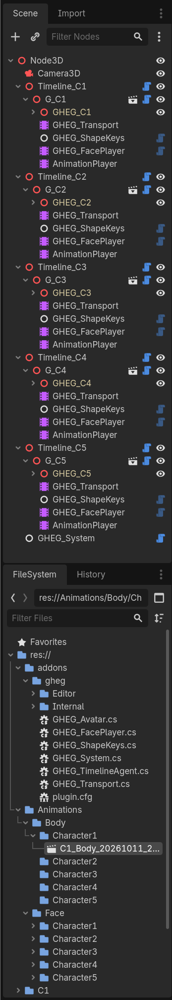
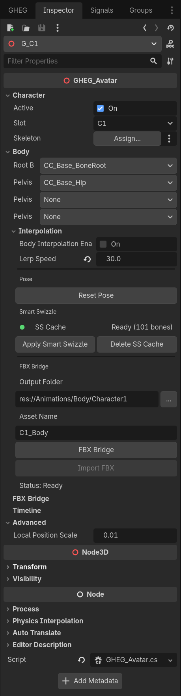
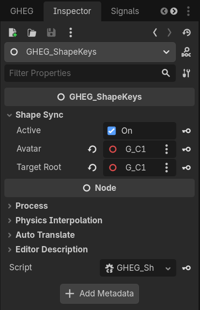
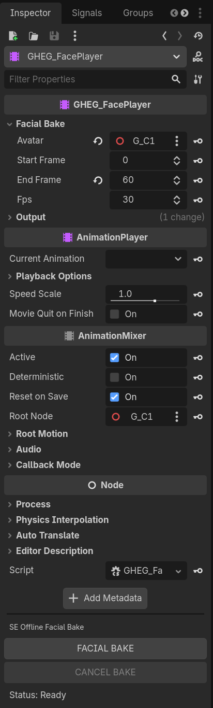
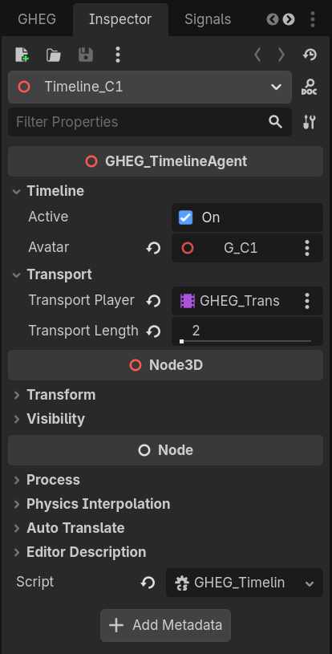
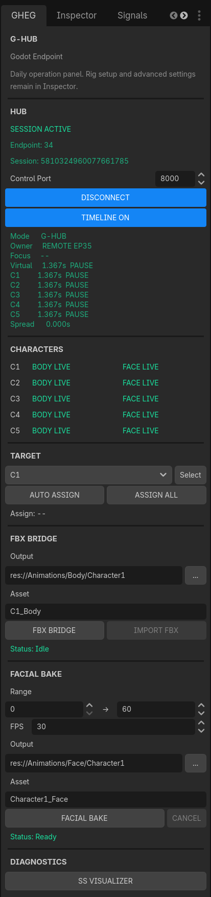
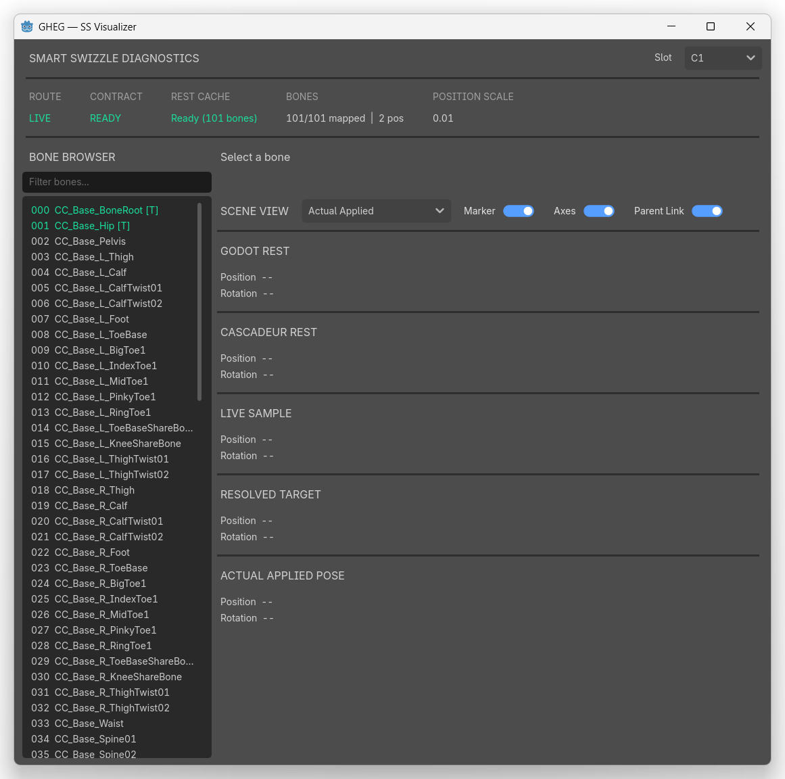

# GHEG — G-HUB Entangle for Godot

**G-HUB Entangle for Godot (GHEG)**는 **TeamGadget Universal Real-Time Sync System (URSS)**의 Godot .NET Endpoint입니다.

GHEG는 Godot를 **G-HUB**에 연결하고, 실시간 Body Synchronization, 실시간 Facial / BlendShape Synchronization, Character Slot Routing, Canonical Timeline Synchronization, Smart Swizzle Diagnostics, Offline Facial Bake, FBX Bridge를 통한 Body Animation Transfer를 제공합니다.

> GHEG v1.0.0은 Editor-side Production Endpoint로 설계되었습니다. Body 및 Facial Animation Asset을 Godot Project로 전달하되, 최종 Character Assembly는 일반적인 Godot Workflow 안에서 사용자가 직접 제어하도록 합니다.


---

## 개요

GHEG는 Cascadeur 또는 ShapeMixer Entangle과 **직접 통신하지 않습니다**.
모든 Endpoint Registration, Character Slot Routing, Canonical Synchronization은 **G-HUB**를 통해 처리됩니다.

```text
Cascadeur / GHEC
       │
       ▼
     G-HUB
       │
       ▼
 Godot / GHEG
```

```text
ShapeMixer Entangle / SE
          │
          ▼
        G-HUB
          │
          ▼
      Godot / GHEG
```

Body와 Facial Synchronization은 동일한 GHEG Endpoint에서 함께 사용할 수 있습니다.

GHEG는 최대 **5 Character Slots**을 지원합니다.

```text
C1  →  char_01
C2  →  char_02
C3  →  char_03
C4  →  char_04
C5  →  char_05
```

Character Identity는 URSS Route / Character Slot이 소유합니다. GHEG는 Bone Name에 Legacy Character Prefix를 요구하지 않습니다.

---

## 기능

- G-HUB를 통한 실시간 Body Synchronization
- G-HUB를 통한 실시간 Facial / BlendShape Synchronization
- 최대 **5 Character Slots**
- C1–C5 독립 Body / Face Routing
- 호환 Character Structure용 Rig-agnostic Body Synchronization
- Smart Swizzle Reference-pose Mapping 및 Persistent Cache
- Floating **SS Visualizer** Diagnostic Window
- Root + 최대 3개의 Pelvis / Translation Bone
- 설정 가능한 Local Position Scale
- 선택적 Body Interpolation
- Canonical G-HUB Timeline Synchronization
- Character Animation Playback과 분리된 Dedicated Timeline Transport Player
- **AUTO ASSIGN** / **ASSIGN ALL** 기반의 명시적이고 안전한 Setup Assistance
- Godot Project로 Body Animation을 전달하는 FBX Bridge
- Native Godot `Animation` Resource로 Offline Facial Animation Bake
- 사용자가 선택할 수 있는 Output Folder 및 Asset Name
- 기본 Log를 최소화하고 필요할 때만 Verbose Diagnostics 활성화

---

## 개발 / 검증 환경

GHEG v1.0.0은 다음 환경을 기준으로 개발 및 검증되었습니다.

- **Godot 4.7.2 .NET**
- Windows 64-bit

검증에 사용한 관련 TeamGadget 컴포넌트:

- **G-HUB v1.0**
- **GHEC v1.0.2**
- **ShapeMixer Entangle v1.0**

> GHEG는 C#으로 구현되어 있으므로 **Godot .NET** Project가 필요합니다.
>
> 다른 Godot Version에서도 동작할 수 있지만, GHEG v1.0.0은 Godot 4.7.2 .NET을 기준으로 검증되었습니다.

---

## 배포

Release Package는 다음 구조를 가진 Godot Add-on으로 배포됩니다.

```text
addons/
└─ gheg/
   ├─ Editor/
   ├─ Internal/
   ├─ GHEG_Avatar.cs
   ├─ GHEG_FacePlayer.cs
   ├─ GHEG_ShapeKeys.cs
   ├─ GHEG_System.cs
   ├─ GHEG_TimelineAgent.cs
   ├─ GHEG_Transport.cs
   └─ plugin.cfg
```

`addons/gheg` Folder를 이름 변경 없이 대상 Godot Project에 복사하십시오.

---

# 설치

## 1. Godot .NET Project 준비

**Godot 4.7 .NET** Project를 새로 만들거나 기존 Project를 엽니다.

완전히 새 Godot .NET Project에는 아직 `.csproj` / `.sln`이 없을 수 있습니다. Godot Editor에 C# Build Control이 표시되지 않는다면 Godot 내부에서 임시 C# Script를 하나 생성하여 .NET Project File을 초기화하십시오.

권장 임시 파일 이름:

```text
Bootstrap.cs
```

Godot가 Project File을 생성한 뒤에는 임시 Script를 삭제해도 됩니다.

> **중요:** 임시 Script 이름을 `Node.cs`로 만들지 마십시오.
>
> Project 수준의 `Node.cs`는 `Godot.Node`와 충돌하여 수많은 오해하기 쉬운 C# Compile Error를 발생시킬 수 있습니다. 임시 Bootstrap Script에는 `Control.cs`, `Window.cs`, `Button.cs` 같은 Godot Engine Type 이름도 피하십시오.

---

## 2. GHEG 설치

Release Add-on을 다음 위치에 복사합니다.

```text
res://addons/gheg/
```

다음 파일이 존재하는지 확인하십시오.

```text
res://addons/gheg/plugin.cfg
```

C# Project를 한 번 Build합니다.

그 후 다음 메뉴를 엽니다.

```text
Project
└─ Project Settings
   └─ Plugins
```

다음을 활성화합니다.

```text
G-HUB Entangle for Godot (GHEG)
```

활성화되면 Godot Editor에서 **GHEG** Dock을 사용할 수 있습니다.

---

# 권장 Scene Structure

GHEG는 URSS Timeline Transport를 Character의 일반 Animation Playback과 의도적으로 분리합니다.

> **Node Name은 자유롭게 정할 수 있습니다.**
>
> 이 Guide의 `Timeline_C1`, `G_C1`, `Character`, `GHEG_ShapeKeys`, `AnimationPlayer` 같은 이름은 예시일 뿐입니다. Project의 Naming Convention에 맞게 Node Instance 이름을 자유롭게 변경할 수 있습니다.
>
> GHEG는 주로 Node Type, 명시적 Inspector Reference, Character Slot Assignment, 그리고 AUTO ASSIGN이 사용하는 예상 Parent / Child Relationship을 통해 Setup을 식별합니다. Sample Name 자체는 Synchronization Contract의 일부가 아닙니다.
>
> `addons/gheg` Add-on Folder 또는 배포된 GHEG Script / Class File 이름은 변경하지 마십시오. Dedicated Timeline Transport에는 `GHEG_Transport` Node Type 사용을 강력히 권장합니다.

권장 1-Character Setup:

```text
Node3D                         [Scene Root]
├─ Timeline_C1                 [Node3D + GHEG_TimelineAgent]
│  └─ G_C1                    [Node3D + GHEG_Avatar]
│     ├─ Character             [Imported GLB / FBX character]
│     │  └─ Skeleton3D
│     ├─ GHEG_Transport        [GHEG_Transport / AnimationPlayer]
│     ├─ GHEG_ShapeKeys        [GHEG_ShapeKeys]
│     ├─ GHEG_FacePlayer       [GHEG_FacePlayer]
│     └─ AnimationPlayer       [Normal final animation playback]
└─ GHEG_System                 [GHEG_System]
```

Multi-character의 경우 동일한 Structure Pattern을 C1–C5에 반복합니다. Node Instance Name은 이 예시와 완전히 달라도 됩니다.

AUTO ASSIGN에서 중요한 Structure Rule은 `GHEG_Transport`, `GHEG_ShapeKeys`, `GHEG_FacePlayer`가 해당 `GHEG_Avatar` Wrapper의 고유한 Direct Child여야 한다는 점입니다. `GHEG_TimelineAgent`는 수동으로 할당한 `Avatar` Reference를 통해 연결됩니다.



---

## GHEG_Transport를 분리하는 이유

`GHEG_Transport`는 Canonical URSS Timeline Transport 전용의 비어 있는 `AnimationPlayer`입니다.

최종 Body Animation Player로 **사용하면 안 됩니다**.

이 분리를 통해 URSS Timeline Cursor가 Imported 또는 Baked Animation Track과 Skeleton Pose Ownership을 두고 충돌하는 것을 방지합니다.

최종 Character Animation Playback에는 일반 `AnimationPlayer`를 사용하십시오.

---

# C1 전체 Setup Guide — Step by Step

이 Chapter에서는 빈 Godot Scene에서 시작하여 **C1**이 정상 동작하는 GHEG Character가 되기까지 전체 과정을 안내합니다.

C1이 정상 동작하면 C2–C5도 Character Slot만 변경하여 같은 절차를 사용할 수 있습니다.

> **아래 Node Name은 예시일 뿐 필수 사항이 아닙니다.**
>
> `Hero`, `Timeline_Main`, `MyCharacter` 또는 원하는 Naming Convention을 사용할 수 있습니다. 중요한 것은 Node Type, Assigned Reference, Character Slot, 그리고 아래 설명된 Structural Relationship입니다.

## 시작 전에 준비할 것

다음 항목을 준비하십시오.

- Godot **4.7.2 .NET** Project
- GHEG 설치 및 활성화
- C# Project가 정상 Build되는 상태
- `Skeleton3D`를 포함하는 Imported Character Scene 1개
- 연결 가능한 G-HUB
- Body Synchronization용 Cascadeur / GHEC
- Face Live / Facial Bake가 필요한 경우 ShapeMixer Entangle

이 예시에서는 다음 Node Name을 사용합니다.

```text
Timeline_C1
G_C1
Character
GHEG_Transport
GHEG_ShapeKeys
GHEG_FacePlayer
AnimationPlayer
GHEG_System
```

다시 말하지만, 이 이름들은 읽기 편하도록 정한 예시일 뿐입니다.

---

## Step 1 — GHEG_System 생성

Scene Root에 다음 Type의 Node를 하나 생성합니다.

```text
GHEG_System
```

편집 중인 Scene에서 편한 위치에 두면 됩니다.

Scene의 GHEG Endpoint는 하나의 `GHEG_System`이 관리해야 합니다.

기본 Control Port는 다음 값을 유지합니다.

```text
8000
```

아직 Connect하지 마십시오. 먼저 C1 Structure를 완성합니다.

---

## Step 2 — C1 Timeline Agent 생성

새 `Node3D`를 만들고 다음 Global Class를 Attach / Create합니다.

```text
GHEG_TimelineAgent
```

이 Guide에서는 Node 이름을 다음처럼 사용합니다.

```text
Timeline_C1
```

이름은 자유입니다.

중요한 점은 `GHEG_TimelineAgent`가 `Node3D`를 상속하므로 Node가 `Node3D`여야 한다는 것입니다.

`Transport Player`는 지금 할당하지 마십시오. 나중에 AUTO ASSIGN이 채웁니다.

---

## Step 3 — C1 Avatar Wrapper 생성

Timeline Agent 아래에 `Node3D`를 만들고 다음을 Attach / Create합니다.

```text
GHEG_Avatar
```

이 Guide에서는 다음 이름을 사용합니다.

```text
G_C1
```

이 Wrapper는 C1의 GHEG Configuration Owner가 됩니다.

Inspector에서 다음을 설정합니다.

```text
Active = On
Slot   = C1
```

다른 Reference는 아직 신경 쓰지 않아도 됩니다.

---

## Step 4 — Original Character를 Avatar Wrapper 아래에 Instance

Imported Character Scene을 `GHEG_Avatar` Wrapper 아래에 Instance하거나 배치합니다.

예:

```text
Timeline_C1
└─ G_C1                  [GHEG_Avatar]
   └─ Character          [Imported GLB / FBX scene]
      └─ ...
         └─ Skeleton3D
```

Imported Character Root 이름은 자유이며, 추가 Node가 포함되어 있어도 됩니다.

Character를 실제로 Drive하는 `Skeleton3D`를 찾으십시오.

---

## Step 5 — Skeleton 및 Translation Bone 할당

`GHEG_Avatar` Wrapper를 선택합니다.

Imported Character의 `Skeleton3D`를 다음 Field에 할당합니다.

```text
Skeleton
```

그 다음 Body 영역을 설정합니다.

```text
Root Bone
Pelvis 1
Pelvis 2    optional
Pelvis 3    optional
```

Bone Selector를 사용해 Character에 맞는 Bone을 선택합니다.

일반적인 Humanoid 예:

```text
Root Bone  → character root / motion root
Pelvis 1   → hip / pelvis bone
Pelvis 2   → additional translation bone이 필요하지 않으면 비움
Pelvis 3   → additional translation bone이 필요하지 않으면 비움
```

`Local Position Scale` 기본값:

```text
0.01
```

Character Translation Scale에 조정이 필요하지 않다면 기본값을 유지하십시오.

Body Interpolation은 선택 사항이며 나중에 활성화할 수 있습니다.



---

## Step 6 — Dedicated Timeline Transport 추가

`GHEG_Avatar` Wrapper의 Direct Child로 다음 Node Type을 생성합니다.

```text
GHEG_Transport
```

예:

```text
G_C1
└─ GHEG_Transport
```

Node Instance Name은 변경해도 됩니다. Node Type 자체가 `GHEG_Transport`임을 식별하기 때문입니다.

가장 단순하고 모호하지 않은 Setup을 위해 Avatar Wrapper마다 정확히 하나의 `GHEG_Transport` Direct Child를 유지하십시오.

이 Node에는 최종 Body Animation을 넣지 마십시오. URSS Timeline Transport 전용입니다.

---

## Step 7 — GHEG_ShapeKeys 추가

Avatar Wrapper의 Direct Child로 다음을 생성합니다.

```text
GHEG_ShapeKeys
```

이 Node는 **Live Facial / BlendShape Synchronization**을 담당합니다.

AUTO ASSIGN을 위해 Character마다 정확히 하나의 `GHEG_ShapeKeys` Direct Child를 유지하십시오.

다음 Field는 지금 비워 둡니다.

```text
Avatar
Target Root
```

AUTO ASSIGN이 자동으로 채웁니다.



---

## Step 8 — GHEG_FacePlayer 추가

Avatar Wrapper의 또 다른 Direct Child로 다음을 생성합니다.

```text
GHEG_FacePlayer
```

이 Node는 **Offline Facial Bake**를 담당합니다.

`Avatar` Field는 지금 비워 둡니다. AUTO ASSIGN이 자동으로 채웁니다.



---

## Step 9 — 최종 Body Animation용 일반 AnimationPlayer 추가

Character Wrapper 아래에 일반 Godot Node를 추가합니다.

```text
AnimationPlayer
```

이 Player는 나중에 FBX Bridge로 전달된 최종 Body Animation Asset을 재생하는 데 사용합니다.

현재 권장 C1 Structure:

```text
Timeline_C1                         [GHEG_TimelineAgent]
└─ G_C1                            [GHEG_Avatar / Slot C1]
   ├─ Character                    [Imported character]
   │  └─ ...
   │     └─ Skeleton3D
   ├─ GHEG_Transport               [URSS timeline only]
   ├─ GHEG_ShapeKeys               [Face Live]
   ├─ GHEG_FacePlayer              [Facial Bake]
   └─ AnimationPlayer              [Final Body animation]

GHEG_System
```

Node Name은 달라도 됩니다. 중요한 것은 Role과 Relationship입니다.


---

## Step 10 — 유일하게 필요한 Manual Anchor 설정

`GHEG_TimelineAgent` Node를 선택합니다.

다음을 수동으로 할당합니다.

```text
Avatar → the C1 GHEG_Avatar wrapper
```

이 Guide에서는:

```text
Timeline_C1.Avatar → G_C1
```

이 Explicit Reference가 Safe AUTO ASSIGN System이 사용하는 Anchor입니다.

`Transport Player`는 비워 둡니다.



---

## Step 11 — AUTO ASSIGN 실행

GHEG Dock을 엽니다.

**TARGET**에서 다음을 선택합니다.

```text
C1
```

다음을 누릅니다.

```text
AUTO ASSIGN
```

표준 Structure에서는 GHEG가 다음 Reference를 채웁니다.

```text
TimelineAgent.TransportPlayer  → C1 GHEG_Transport
GHEG_ShapeKeys.Avatar          → C1 GHEG_Avatar
GHEG_ShapeKeys.TargetRoot      → C1 GHEG_Avatar
GHEG_FacePlayer.Avatar         → C1 GHEG_Avatar
```

예상 결과:

```text
Assign: COMPLETE
```

`PARTIAL`이 표시되면 추측하지 마십시오. Dock이 보고한 Missing Item을 확인하십시오.

가장 흔한 원인:

- `TimelineAgent.Avatar`가 수동으로 할당되지 않음
- 일치하는 Direct Child가 둘 이상 존재함
- `GHEG_Transport` 누락
- `GHEG_ShapeKeys` 누락
- `GHEG_FacePlayer` 누락

---

## Step 12 — Scene 저장

AUTO ASSIGN 후 Scene을 저장합니다.

Explicit Reference와 이후 생성되는 Smart Swizzle Cache가 Scene Configuration과 함께 저장됩니다.

---

## Step 13 — G-HUB / GHEC에서 C1 Route 준비

GHEG를 연결하기 전에 Source Side가 동일한 Character Slot을 사용하도록 준비되어 있는지 확인합니다.

```text
C1 → char_01
```

Body Live를 사용하려면 GHEC / Cascadeur에서 대상 C1 Character를 노출해야 합니다.

Face Live를 사용하려면 ShapeMixer Entangle에서 대응하는 C1 Face Route를 사용해야 합니다.

Character Identity는 URSS Character Slot이 제공합니다. Bone Name에는 Legacy `character1:` 형식 Prefix가 필요하지 않습니다.

---

## Step 14 — GHEG를 G-HUB에 연결

GHEG Dock에서 Control Port를 확인한 후 다음을 누릅니다.

```text
CONNECT
```

Character Status는 일반적으로 다음처럼 진행됩니다.

```text
WAIT → ROUTED → LIVE
```

Active Route에 따라 C1에 다음이 표시될 수 있습니다.

```text
BODY LIVE
FACE LIVE
```

또는 둘 다 표시될 수 있습니다.



---

## Step 15 — C1에 Smart Swizzle 적용

Smart Swizzle에는 Active G-HUB Character Route가 필요합니다.

C1이 Routed 상태에서 `GHEG_Avatar` Wrapper를 선택하고 다음을 누릅니다.

```text
Apply Smart Swizzle
```

GHEG는 Source Reference Pose를 요청하고 Mapping Cache를 생성합니다.

예상 Cache State:

```text
Ready
```

Character, Skeleton 또는 Request Signature 변경 후 Cache가 `Stale`이라면 Smart Swizzle을 다시 적용하십시오.

Rest Pose, Resolved Target, Actual Applied Pose, Translation Mapping 또는 개별 Bone을 확인하려면 SS Visualizer를 사용하십시오.

---

## Step 16 — Body Live 확인

Cascadeur에서 C1 Character를 움직이거나 Playback합니다.

Godot에서 다음을 확인하십시오.

- 예상 Bone이 움직이는지
- Root / Pelvis Translation이 올바른지
- 다른 Character가 C1 Data를 받지 않는지
- GHEG Dock에 `BODY LIVE`가 표시되는지

Translation Distance가 잘못된 경우 C1 `GHEG_Avatar`의 `Local Position Scale`을 조정하십시오.

Motion Smoothing이 필요하면 Body Interpolation을 활성화하고 Lerp Speed를 조정합니다.

---

## Step 17 — Face Live 확인

ShapeMixer Entangle을 사용하는 경우 C1 Facial Control 하나 이상을 변경합니다.

대응하는 Godot BlendShape가 반응하고 Dock에 다음이 표시되는지 확인하십시오.

```text
FACE LIVE
```

`GHEG_ShapeKeys.TargetRoot`는 일반적으로 Avatar Wrapper를 가리키며, 해당 Wrapper 아래의 Imported Character Hierarchy를 검색할 수 있도록 합니다.

---

## Step 18 — 선택적 Timeline Test

Endpoint 수준의 Timeline Synchronization은 기본적으로 OFF입니다.

필요할 때만 GHEG Dock에서 활성화하십시오.

Canonical URSS Timeline을 Scrub 또는 Play하고 C1이 Dedicated `GHEG_Transport`를 통해 따라오는지 확인합니다.

일반적인 최종 Animation용 `AnimationPlayer`는 Transport Player와 분리된 상태를 유지해야 합니다.

---

## Step 19 — C1 Setup 완료

이 시점에서 C1 Authoring Setup이 완료됩니다.

이제 다음 기능을 사용할 수 있습니다.

- Body Live Synchronization
- Face Live Synchronization
- Canonical Timeline Synchronization
- SS Visualizer Diagnostics
- FBX Bridge Body Bake / Transfer
- Offline Facial Bake

C2–C5는 동일한 Structure를 반복하고 Avatar Character Slot과 대응 URSS Route Assignment만 변경합니다.

모든 Avatar Anchor를 설정한 후 **ASSIGN ALL**을 사용하면 설정된 모든 Slot의 Safe Reference를 한 번에 채울 수 있습니다.

---

# Component Setup Reference

## 1. GHEG_System 추가

다음 Script를 Attach한 Node를 하나 생성합니다.

```text
GHEG_System
```

Scene에는 GHEG Endpoint System이 하나만 필요합니다.

Endpoint Control Port 기본값:

```text
8000
```

---

## 2. GHEG_TimelineAgent 추가

Character Timeline용 `Node3D`를 하나 생성합니다. 예:

```text
Timeline_C1
```

다음을 Attach합니다.

```text
GHEG_TimelineAgent
```

`GHEG_TimelineAgent`는 `Node3D`를 상속하므로 일반 `Node`가 아닌 `Node3D`를 사용하십시오.

`Avatar` Field는 대응하는 `GHEG_Avatar` Node에 수동으로 설정합니다. 이 Explicit Avatar Reference가 GHEG Safe Assignment System에서 Setup Anchor 역할을 합니다.


---

## 3. GHEG_Avatar 추가

Character Wrapper를 생성합니다. 예:

```text
G_C1
```

다음을 Attach합니다.

```text
GHEG_Avatar
```

Imported Character Scene을 이 Wrapper 아래에 배치하고 Inspector에서 Character의 `Skeleton3D`를 할당합니다.

설정 항목:

- **Slot** — C1 ~ C5
- **Skeleton** — Destination `Skeleton3D`
- **Root B** — Root Translation Bone
- **Pelvis 1** — Primary Pelvis / Hip Translation Bone
- **Pelvis 2** — 선택적 Additional Translation Bone
- **Pelvis 3** — 선택적 Additional Translation Bone
- **Body Interpolation** — 선택적 Smoothing
- **Lerp Speed** — Interpolation Speed
- **Local Position Scale** — Translation Scale, 기본 `0.01`

Root / Pelvis Bone Selector는 할당된 Skeleton3D Bone List를 사용합니다.


---

## 4. GHEG_Transport 추가

Character Wrapper의 Direct Child로 다음 Type의 Node를 추가합니다.

```text
GHEG_Transport
```

`GHEG_Transport`는 Godot **Create New Node** Dialog에서 직접 생성할 수 있습니다.

---

## 5. GHEG_ShapeKeys 추가

실시간 Facial Synchronization이 필요하면 Character Wrapper의 Direct Child로 다음을 추가합니다.

```text
GHEG_ShapeKeys
```

`GHEG_ShapeKeys`는 **Live Facial Synchronization**을 담당합니다.


---

## 6. GHEG_FacePlayer 추가

Offline Facial Bake가 필요하면 Character Wrapper의 Direct Child로 다음을 추가합니다.

```text
GHEG_FacePlayer
```

`GHEG_FacePlayer`는 `AnimationPlayer`를 상속하며 **Offline Facial Bake**를 담당합니다.


---

## 7. 일반 AnimationPlayer 추가

최종 Body Animation Playback용 일반 Godot `AnimationPlayer`를 추가합니다.

이는 다음 Node와 의도적으로 분리됩니다.

```text
GHEG_Transport
```

FBX Bridge Transfer 후 최종 Body Animation은 일반 `AnimationPlayer`에 배치해야 합니다.

---

# AUTO ASSIGN / ASSIGN ALL

GHEG v1.0.0은 사용자의 Scene Hierarchy를 공격적으로 재구성하지 않습니다.

대신 명시적인 Safe Assignment Tool을 제공합니다.

AUTO ASSIGN 사용 전:

1. Character Node Structure를 구성합니다.
2. `GHEG_TimelineAgent.Avatar`를 수동으로 설정합니다.
3. GHEG Dock에서 Target Character Slot을 선택합니다.
4. **AUTO ASSIGN**을 누릅니다.

AUTO ASSIGN은 Structure상 모호하지 않은 Reference만 채웁니다.

```text
TimelineAgent.TransportPlayer  → GHEG_Transport
GHEG_ShapeKeys.Avatar          → GHEG_Avatar
GHEG_ShapeKeys.TargetRoot      → GHEG_Avatar
GHEG_FacePlayer.Avatar         → GHEG_Avatar
```

필요 Node가 없거나 후보가 모호하면 GHEG는 추측하지 않고 Partial Assignment를 보고합니다.

Multi-character Scene이 구성된 경우 **ASSIGN ALL**을 눌러 유효한 모든 Character Slot에 동일한 Safe Assignment를 실행할 수 있습니다. Empty Slot은 건너뜁니다.

> AUTO ASSIGN은 Skeleton, Root Bone, Pelvis Bone 또는 Imported Character Hierarchy를 추측하지 않습니다.

---

# GHEG Control Dock

GHEG Dock은 일상 작업용 Operation Panel입니다.
Advanced Rig Configuration은 Godot Inspector에 유지됩니다.


Dock 구성:

### HUB

- G-HUB Session State
- Endpoint ID
- Session ID
- Control Port
- Connect / Disconnect
- Timeline ON / OFF
- Canonical Timeline Monitor

### CHARACTERS

C1–C5 Body / Face State를 표시합니다.

일반적인 State 진행:

```text
-- → WAIT → ROUTED → LIVE
```

### TARGET

Setup, FBX Bridge, Facial Bake, Inspector Selection Action에 사용할 Character Slot을 선택합니다.

### FBX BRIDGE

- Output Folder
- Asset Name
- FBX Bridge Request
- Godot FBX Import
- Import / Operation Status

### FACIAL BAKE

- Start / End Frame
- FPS
- Output Folder
- Asset Name
- Bake / Cancel

### DIAGNOSTICS

Floating **SS Visualizer**를 엽니다.

---

# G-HUB 연결

1. G-HUB를 실행합니다.
2. Body Synchronization이 필요하면 Cascadeur에서 GHEC를 실행 / 연결합니다.
3. Facial Synchronization이 필요하면 ShapeMixer Entangle을 실행합니다.
4. 대응하는 C1–C5 Assignment를 확인합니다.
5. Godot에서 GHEG Dock의 **CONNECT**를 누릅니다.

Routing이 성공하면 해당 Character Slot이 `BODY LIVE` 및/또는 `FACE LIVE` 상태로 변경됩니다.

GHEG는 하나의 Endpoint Session에서 최대 5개의 Active Character Slot을 지원합니다.

---

# Smart Swizzle

Smart Swizzle은 호환되는 Source / Destination Skeleton 사이의 Reference-pose Coordinate 차이를 해결합니다.

각 Character에 대해:

1. Destination `Skeleton3D`를 할당합니다.
2. Source / Destination Character가 호환되는 Reference Pose에 있는지 확인합니다.
3. `GHEG_Avatar`에서 **Apply Smart Swizzle**을 사용합니다.
4. SS Cache가 `Ready`로 표시되는지 확인합니다.

Cached Smart Swizzle 결과는 Scene Configuration과 함께 저장됩니다.

Character Structure 또는 Request Signature가 변경되면 Cache가 `Stale`이 될 수 있습니다. 필요한 경우 다시 Build하십시오.

---

# SS Visualizer

**SS Visualizer**는 Smart Swizzle 및 Resolved Pose를 검사하는 Floating Diagnostic Tool입니다.



제공 기능:

- C1–C5 Slot Selection
- Route / UDP State
- Pose Contract State
- Smart Swizzle Cache State
- Mapped Bone / Translation Count
- Local Position Scale
- Searchable Bone Browser
- Godot Rest
- Cascadeur Rest
- Live Sample
- Resolved Target
- Actual Applied Pose
- Scene-view Marker
- XYZ Axis
- Parent Link Visualization

SS Visualizer는 진단 및 검증에 사용하십시오. Character 설정이 성공한 뒤 일반 사용에는 필요하지 않습니다.

---

# Timeline Synchronization

GHEG는 G-HUB Canonical Timeline System에 참여합니다.

Timeline Synchronization은 GHEG Dock에서 제어하며 Endpoint System에서는 기본적으로 **OFF**입니다.

각 Character Slot은 고유한 `GHEG_TimelineAgent`와 Dedicated `GHEG_Transport` Player를 사용합니다.

Transport Player에는 Character Animation Track이 없습니다. 목적은 Canonical Time 및 Playback State를 표현하는 것뿐입니다.

이 구조를 통해 Timeline Transport를 Live Body Pose Ownership 및 Final Animation Playback과 독립적으로 유지합니다.

---

# Body Animation — FBX Bridge

FBX Bridge는 URSS / Cascadeur Workflow에서 Baked Body Animation을 Godot Project로 전달합니다.

## 기본 Workflow

1. GHEG Dock에서 Character Slot을 선택합니다.
2. Output Folder와 Asset Name을 설정합니다.
3. **FBX BRIDGE**를 누릅니다.
4. Transfer 완료를 기다립니다.
5. Imported Resource가 아직 없다면 **IMPORT FBX**를 누릅니다.
6. Imported FBX가 Godot FileSystem에 `PackedScene`으로 나타나는지 확인합니다.
7. Imported Result를 열고 Animation을 확인합니다.

기본 Output Root:

```text
res://
```

GHEG는 현재 Editor Session 동안 Character Slot 전환 시 마지막으로 선택한 Body Output Folder를 기억합니다.

---

## Body Animation을 Original Character에 적용

GHEG v1.0.0은 유효한 Body Animation Asset을 Godot Project에 전달하는 지점에서 의도적으로 종료합니다.

Production Character에 최종 적용하는 과정은 일반적인 Godot Workflow이며 사용자가 수동으로 수행합니다.

Godot는 Imported FBX `AnimationLibrary`를 다음처럼 표시할 수 있습니다.

```text
[foreign]
```

Animation을 Copy할 수 없는 경우:

1. Imported FBX Scene을 엽니다.
2. 해당 `AnimationPlayer` / `AnimationLibrary`를 찾습니다.
3. **Make Animation Library Unique**를 사용합니다.
4. 필요한 Animation을 복사합니다.
5. Original Character의 일반 `AnimationPlayer`에 붙여넣습니다.

> 최종 Body Animation을 `GHEG_Transport`에 붙여넣지 마십시오.
>
> `GHEG_Transport`는 URSS Timeline Transport 전용입니다.

Animation Transfer 후에는 사용자의 Production Character를 일반 Project Hierarchy로 되돌리고 다른 Godot Animated Character와 동일하게 사용할 수 있습니다.

---

# Facial Synchronization

`GHEG_ShapeKeys`가 실시간 Facial Synchronization을 담당합니다.

Routed Face Slot의 흐름:

```text
ShapeMixer Entangle
        │
        ▼
      G-HUB
        │
        ▼
GHEG_ShapeKeys
        │
        ▼
Godot Blend Shapes
```

표준 GHEG Node Structure를 사용하는 경우 AUTO ASSIGN을 통해 Character의 `Avatar` 및 `Target Root` Reference를 채울 수 있습니다.

---

# Offline Facial Bake

`GHEG_FacePlayer`는 Routed ShapeMixer Entangle Animation을 Native Godot `Animation` Resource로 변환합니다.

## 기본 Workflow

1. Face Route가 Live인지 확인합니다.
2. GHEG Dock에서 Character Slot을 선택합니다.
3. Start Frame, End Frame, FPS를 설정합니다.
4. Output Folder와 Asset Name을 선택합니다.
5. **FACIAL BAKE**를 누릅니다.
6. Bake 완료를 기다립니다.

Baked Result는 독립된 `.tres` Godot `Animation` Resource로 저장되며 `GHEG_FacePlayer` Preview Library에서도 사용할 수 있습니다.

GHEG는 현재 Editor Session 동안 Character Slot 전환 시 마지막으로 선택한 Facial Bake Output Folder를 기억합니다.

생성된 Animation은 Project의 일반적인 Godot Animation Workflow를 통해 Production Character에 적용할 수 있습니다.

---

# Multi-Character Workflow

GHEG v1.0.0은 하나의 Godot Endpoint에서 C1–C5를 지원합니다.

검증된 5-Character Scene은 다음 Pattern을 따릅니다. 아래 이름은 예시일 뿐이며 각 Node Instance는 자유롭게 이름을 변경할 수 있습니다.

```text
Timeline_C1 → G_C1 → C1 character components
Timeline_C2 → G_C2 → C2 character components
Timeline_C3 → G_C3 → C3 character components
Timeline_C4 → G_C4 → C4 character components
Timeline_C5 → G_C5 → C5 character components
GHEG_System
```

C1–C5 전체에서 다음 항목이 검증되었습니다.

- Body Live Synchronization
- Facial Live Synchronization
- Timeline Synchronization
- FBX Bridge Body Animation Transfer
- Original Character에 Body Animation 적용
- Offline Facial Bake
- Cross-talk 없는 Route Separation

---

# Logging / Diagnostics

일반적인 GHEG Logging은 의도적으로 간결하게 유지됩니다.

Operation Completion Message, Warning, Error는 계속 표시되지만, 세부 Internal Routing / Packet Diagnostic은 기본적으로 숨겨집니다.

더 깊은 Troubleshooting이 필요한 경우 다음을 활성화하십시오.

```text
GHEG_System
└─ Diagnostics
   └─ Verbose Logging
```

Verbose Mode는 Endpoint, Route, Channel, Pose 및 Internal Diagnostic에 대한 자세한 Log를 다시 활성화합니다.

---

# Known Notes / Limitations

## Godot FBX Import Warning

Godot 4.7.2는 일부 FBX Import 과정에서 Normalization / Rendering Warning을 출력할 수 있습니다.

GHEG 검증에서는 이러한 Message가 표시되어도 Imported Asset 및 Animation Data가 정상적으로 유지되었습니다.

기능 검증은 실제 Imported Result를 기준으로 판단하십시오.

## 최종 Character Assembly는 수동

GHEG v1.0.0은 Body / Facial Animation Asset을 Project로 전달하지만 사용자의 최종 Production Character Hierarchy를 자동 재구성하지 않습니다.

이는 의도적인 설계입니다.

사용자는 다음 항목을 직접 제어합니다.

- 최종 Character Scene Hierarchy
- 최종 일반 `AnimationPlayer`
- Imported AnimationLibrary Organization
- Production Asset Naming / Storage
- 최종 Runtime Playback Integration

## Safe Assignment Only

AUTO ASSIGN은 모호한 Scene Structure를 추론하거나 다시 작성하지 않습니다.

다음 작업을 수행하지 않습니다.

- Character Wrapper 자동 생성
- Imported Character Hierarchy 수정
- Skeleton3D 추측
- Root / Pelvis Bone 추측
- 사용자 일반 AnimationPlayer 교체
- Production Scene 재구성

---

# 문제 해결

## GHEG Plugin이 표시되지 않는 경우

다음 파일이 존재하는지 확인합니다.

```text
res://addons/gheg/plugin.cfg
```

그리고 C# Project가 정상적으로 Build되는지 확인합니다.

Project에 `.csproj`가 없다면 먼저 임시 C# Script를 생성하여 Godot .NET Project를 초기화하십시오.

---

## 임시 Script 생성 후 많은 C# Error가 발생한 경우

Script 이름이 `Node.cs`였다면 이름을 변경하거나 삭제한 뒤 다시 Build하십시오.

해당 File Name은 `Godot.Node`와 충돌하여 서로 관련 없어 보이는 많은 Error를 유발할 수 있습니다.

다음처럼 중립적인 이름을 사용하십시오.

```text
Bootstrap.cs
```

---

## AUTO ASSIGN이 PARTIAL을 보고하는 경우

다음을 확인하십시오.

- `GHEG_TimelineAgent.Avatar`가 수동으로 할당되어 있는지
- 해당 Character에 정확히 하나의 `GHEG_Transport`가 있는지
- Face Live가 필요하다면 정확히 하나의 `GHEG_ShapeKeys`가 있는지
- Facial Bake가 필요하다면 정확히 하나의 `GHEG_FacePlayer`가 있는지

GHEG는 모호한 Assignment를 의도적으로 거부합니다.

---

## Face Route를 사용할 수 없는 경우

`GHEG_ShapeKeys`가 Active이고 Avatar / Target Root Reference가 할당되어 있는지 확인하십시오.

미할당 ShapeKeys Component는 Fatal Endpoint Error가 아니라 Setup WAIT State로 처리됩니다.

---

## FBX Bridge는 완료됐지만 Animation을 Copy할 수 없는 경우

Imported AnimationLibrary가 `[foreign]`으로 표시될 수 있습니다.

Original Character의 일반 `AnimationPlayer`로 Animation을 복사하기 전에 **Make Animation Library Unique**를 사용하십시오.

---

# License

GHEG는 Release Package 및 이 Documentation Directory에 포함된 License 조건에 따라 배포됩니다.

다음을 확인하십시오.

[`LICENSE.txt`](LICENSE.txt)

---

# 관련 URSS Component

- **G-HUB** — 중앙 Endpoint / Route / Timeline Controller
- **GHEC** — Cascadeur Endpoint
- **GHEU** — Unity Endpoint
- **GHEB** — Blender Endpoint
- **ShapeMixer Entangle (SE)** — Facial / Shape Key Authoring Endpoint

모든 Synchronization Route는 G-HUB를 통해 조정됩니다.

---

## GHEG v1.0.0

**G-HUB Entangle for Godot**  
TeamGadget  
Godot 4.7 .NET Endpoint
