# GHEU v1.0.1 — G-HUB Entangle for Unity

**G-HUB Entangle for Unity (GHEU)**는 G-HUB를 통해 Unity와 함께 사용하도록 설계된 독립적인 TeamGadget 동기화 컴포넌트입니다.

GHEU는 Unity를 **TeamGadget Universal Real-Time Sync System**에 연결하고, 실시간 Body 동기화, Facial / BlendShape 동기화, Character Slot Routing, Canonical Timeline 동기화, Smart Swizzle 진단, Offline Facial Bake, FBX Bridge를 통한 Animation Transfer를 제공합니다.

> GHEU는 일반적인 작업을 GHEU Control Window에 간결하게 모으고, Character별 세부 설정과 Diagnostic 설정은 Unity Inspector에 유지합니다.

---

## 개요

GHEU는 TeamGadget 동기화 시스템의 Unity 측 Endpoint입니다.

GHEU는 Cascadeur, Blender, ShapeMixer Entangle 또는 기타 애플리케이션과 **직접 통신하지 않습니다**.  
모든 Routing과 Synchronization은 **G-HUB**를 통해 처리됩니다.

```text
Cascadeur / GHEC
       │
       ▼
     G-HUB
       │
       ▼
Unity / GHEU
```

GHEU는 **Humanoid** 및 **Generic** Character Workflow를 공식 지원합니다.

- **Humanoid**  
  유효한 **Unity Humanoid Avatar**가 할당된 Character에서 사용합니다.

  Unity의 Humanoid Animation System으로 설정된 Humanoid Character의 표준 선택입니다.

- **Generic**  
  Unity Humanoid Avatar를 사용하지 않는 Character에서 사용합니다.

  Creature, Quadruped, Mechanical Character 및 기타 Custom Rig 같은 Non-humanoid Bone-driven Character가 포함됩니다.

  Humanoid 형태의 Character도 Humanoid Avatar 대신 Generic으로 설정되어 있다면 Generic Mode를 사용할 수 있습니다.

즉, GHEU는 Humanoid Character에만 제한되지 않습니다.

실제 Synchronization 호환성은 Cascadeur와 Unity 양쪽에서 제공되는 Character Hierarchy, Bone Name, Reference Pose, Transform Structure에 따라 달라집니다.

호환되는 Character Structure를 가진 Non-humanoid Bone-driven Character도 포함됩니다.

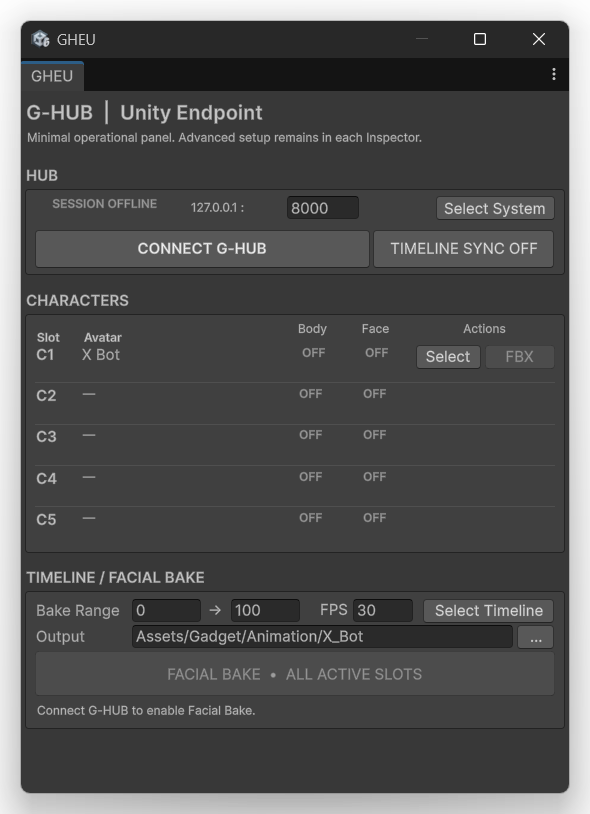

---

## 개발 / 검증 환경

GHEU v1.0.1은 다음 환경을 기준으로 개발 및 검증되었습니다.

- **Unity 6.3 LTS**
- Windows 64-bit

검증에 사용한 관련 TeamGadget 환경:

- **G-HUB v1.0**
- **GHEC v1.0.2**
- **Cascadeur 2026.2.2 — Windows 64-bit**

> GHEU v1.0.1은 Unity 6.3 LTS를 공식 지원합니다. 다른 Unity Version은 이 Release의 공식 지원 대상이 아닙니다.

---

## 배포

GHEU v1.0.1은 Unity Package 형태로 배포됩니다.

```text
GHEU_v1.0.1_6.3LTS.unitypackage
```

Synchronization Data를 받을 Unity Project에 Package를 Import하십시오.

---

# 설치

## 1. Unity Package Import

다음 Package를 Unity Project에 Import합니다.

```text
GHEU_v1.0.1_6.3LTS.unitypackage
```

Import 후 GHEU Runtime Script는 TeamGadget G-HUB Directory 아래에 설치됩니다.

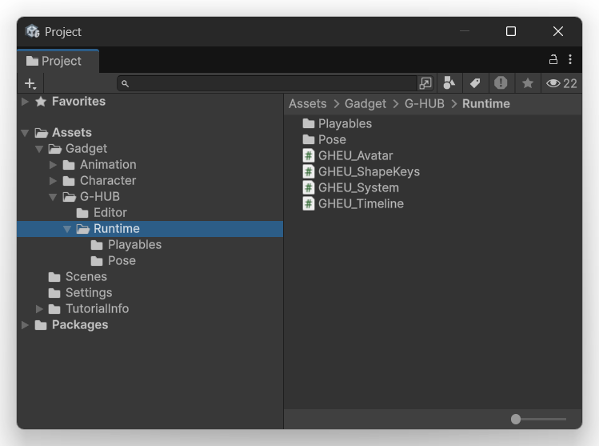

주요 Runtime Component:

- `GHEU_Avatar`
- `GHEU_ShapeKeys`
- `GHEU_System`
- `GHEU_Timeline`

추가 Playables 및 Pose 관련 Runtime File은 각각의 Folder에 포함됩니다.

---

## 2. Scene Component 생성

GHEU에는 여러 Internal Runtime / Editor Script가 포함되어 있지만, 사용자가 일반적으로 직접 다루는 것은 다음 네 가지 Component입니다.

- `GHEU_System.cs`
- `GHEU_Timeline.cs`
- `GHEU_Avatar.cs`
- `GHEU_ShapeKeys.cs`

그 밖의 GHEU Script는 내부 Support Component이며 일반적으로 사용자가 직접 추가하거나 설정할 필요가 없습니다.

### 2.1 GHEU System Object 생성

1. Unity **Hierarchy**에서 Empty GameObject를 생성합니다.
2. `GHEU_System.cs`를 Drag & Drop하거나 **Add Component**를 사용해 GameObject에 Attach합니다.
3. GameObject 이름은 자유롭게 변경할 수 있습니다.

예:

```text
GHEU_System
```

`GHEU_System`은 Unity Endpoint와 G-HUB 간 연결을 관리합니다.

---

### 2.2 GHEU Timeline Object 생성

1. Unity **Hierarchy**에서 또 다른 Empty GameObject를 생성합니다.
2. `GHEU_Timeline.cs`를 Drag & Drop하거나 **Add Component**를 사용해 Attach합니다.
3. GameObject 이름은 자유롭게 변경할 수 있습니다.

`GHEU_Timeline.cs`를 Attach하면 GHEU에 필요한 Unity `PlayableDirector` 기능이 자동으로 구성됩니다.

예:

```text
GHEU_Timeline
```

`GHEU_Timeline`은 Timeline 관련 Bake 설정과 Multi-character Facial Bake를 관리합니다.

---

### 2.3 Character에 Body Synchronization 추가

Unity **Hierarchy**에서 Imported Character를 선택하고 다음 Script를 Attach합니다.

```text
GHEU_Avatar.cs
```

`GHEU_Avatar`는 Body Synchronization에 필요합니다.

관리 항목:

- Character Slot Assignment
- Humanoid / Generic 선택
- Root Motion 설정
- Root Swizzle
- Interpolation
- Smart Swizzle
- FBX Bridge

---

### 2.4 필요한 경우 Facial Synchronization 추가

Facial / BlendShape Synchronization도 필요하다면 같은 Character에 다음 Script를 Attach합니다.

```text
GHEU_ShapeKeys.cs
```

`GHEU_ShapeKeys`는 선택 사항입니다.

Facial / BlendShape Synchronization 또는 Facial Bake를 사용할 때만 필요합니다.

---

### 일반적인 Scene 구성

일반적인 Scene은 다음과 같습니다.

```text
SampleScene
├─ Main Camera
├─ Directional Light
├─ Global Volume
├─ GHEU_System
├─ GHEU_Timeline
└─ Character
   ├─ GHEU_Avatar
   └─ GHEU_ShapeKeys   (optional)
```

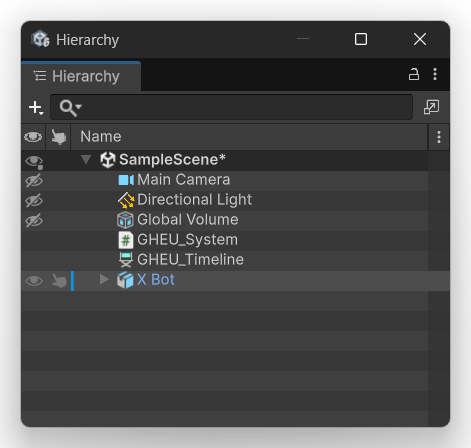

> 일반적인 GHEU 사용 시 직접 다루어야 하는 Script는 다음 네 개뿐입니다.
>
> - `GHEU_System.cs`
> - `GHEU_Timeline.cs`
> - `GHEU_Avatar.cs`
> - `GHEU_ShapeKeys.cs`
>
> 그 외 GHEU Script는 Support Component이며 일반적으로 직접 Attach하거나 설정할 필요가 없습니다.

---

## 3. GHEU Tool 열기

Unity Editor Menu에서 다음을 사용합니다.

```text
Gadget
└─ G-HUB
   ├─ GHEU Control
   └─ SS Visualizer
```

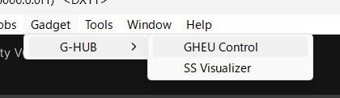

- **GHEU Control** — Compact Operational Window를 엽니다.
- **SS Visualizer** — Smart Swizzle Diagnostic Visualizer를 엽니다.

---

# Character Setup 요구 사항

Body Synchronization을 시작하기 전에 Cascadeur와 Unity 양쪽에서 Character를 준비하십시오.

## 1. 동일한 Character 사용

**Cascadeur**와 **Unity** 양쪽에 동일한 Character를 준비합니다.

GHEU는 Cascadeur의 Source Character와 Unity의 Destination Character 사이에서 대응하는 Bone Structure를 동기화합니다.

---

## 2. 일치하는 Reference Pose 사용

초기 Synchronization 전에 두 Character를 동일한 Reference Pose에 배치해야 합니다.

권장 Reference Pose:

- **T-pose**
- **A-pose**

양쪽에서 동일한 Pose를 사용하십시오.

예를 들어 Cascadeur는 T-pose인데 Unity Character는 A-pose인 상태로 사용하지 마십시오.

Reference Pose는 Smart Swizzle / Reference-pose Initialization 과정에서 사용되므로 중요합니다.

---

## 3. Bone Hierarchy와 Bone Name 일치

Cascadeur와 Unity Character는 다음 항목이 서로 대응되어야 합니다.

- Bone Hierarchy
- Bone Structure
- Bone Name

GHEU는 사용자가 직접 Bone Mapping을 작성할 필요를 없애도록 설계되어 있지만, 양쪽 Character Structure가 호환되어야 합니다.

동일한 Bone은 Cascadeur와 Unity 양쪽에서 동일한 Character 부위를 의미해야 합니다.

---

## 4. GHEU는 Humanoid Character에 제한되지 않습니다

GHEU는 Unity Humanoid Rig에만 제한되지 않습니다.

GHEU v1.0.1 공식 지원:

- **Humanoid**
- **Generic**

따라서 Non-humanoid Bone-driven Character도 동기화할 수 있습니다.

예:

- Quadruped
- Creature
- Mechanical Character
- 기타 Custom Bone-driven Rig

단, **가능한 모든 Rig가 반드시 정상 동기화된다고 보장할 수는 없습니다**.

성공적인 Synchronization은 다음 요소에 따라 달라집니다.

- 일치하는 Bone Hierarchy
- 일치하는 Bone Name
- 호환 가능한 Reference Pose
- 호환 가능한 Transform Structure
- 양쪽 애플리케이션에서 제공되는 Character Data

Character가 예상대로 동기화되지 않는다면 **SS Visualizer**를 사용해 Smart Swizzle / Reference-pose Pipeline을 확인하십시오.

# 빠른 시작 — Body Synchronization

1. **G-HUB**를 실행합니다.
2. **Cascadeur**를 실행하고 **G-HUB Entangle for Cascadeur (GHEC)**를 연결합니다.
3. GHEU가 포함된 Unity Project를 엽니다.
4. Scene에 `GHEU_System`을 추가하거나 선택합니다.
5. Character에 `GHEU_Avatar`를 추가합니다.
6. 필요한 **Character Slot**을 지정합니다.
7. 올바른 **Rig Type**을 선택합니다: `Humanoid` 또는 `Generic`.
8. **Body Sync Enabled**를 활성화합니다.
9. **Gadget > G-HUB > GHEU Control**을 엽니다.
10. **CONNECT G-HUB**를 누릅니다.
11. 대응하는 Character Route가 Active 상태가 되는지 확인합니다.
12. 필요하면 **TIMELINE SYNC**를 활성화합니다.

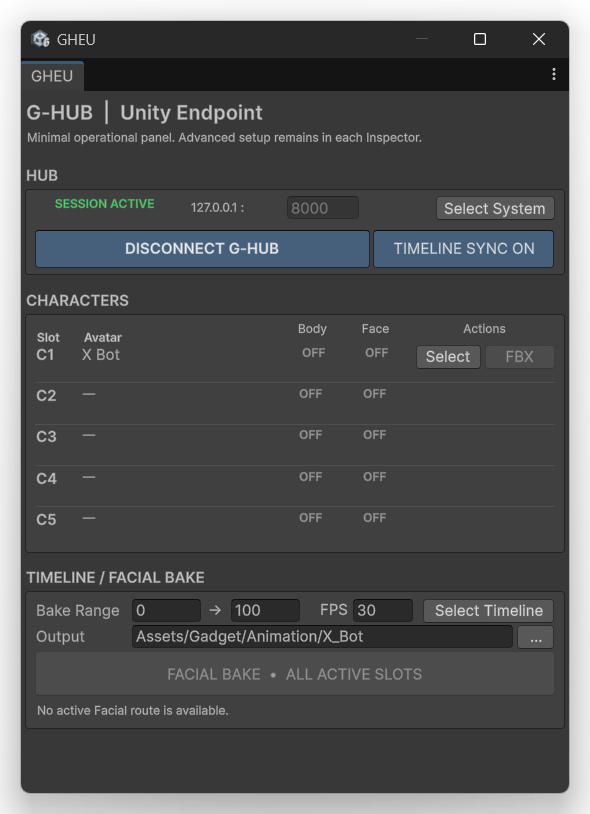

---

# GHEU Control Window

GHEU Control Window는 일상적인 운영을 위한 창입니다.

Unity Editor의 좁은 Dock 영역에도 배치할 수 있도록 의도적으로 Compact하게 설계되었습니다.

## HUB

HUB 영역에는 현재 Active G-HUB Session이 표시됩니다.

Offline 상태:

- `SESSION OFFLINE`
- `CONNECT G-HUB`
- `TIMELINE SYNC OFF`

Connected 상태:

- `SESSION ACTIVE`
- `DISCONNECT G-HUB`
- `TIMELINE SYNC ON`

Window에는 다음 항목도 표시됩니다.

- Host
- Control Port
- **Select System**

`Select System`은 Control Window가 사용할 `GHEU_System` Instance를 선택합니다.

---

## CHARACTERS

GHEU는 최대 **5 Character Slots**을 지원합니다.

- C1
- C2
- C3
- C4
- C5

각 Row에는 다음 항목이 표시됩니다.

- **Slot**
- **Avatar**
- **Body**
- **Face**
- **Actions**

Action 예:

- **Select** — Unity에서 할당된 Character를 선택합니다.
- **FBX** — 사용 가능한 경우 FBX Bridge Workflow를 시작합니다.

Body / Face 상태는 대응하는 G-HUB Route의 Active 여부를 나타냅니다.

---

## TIMELINE / FACIAL BAKE

하단 영역에는 공유 Timeline 및 Facial Bake Control이 있습니다.

- Bake Range
- FPS
- Select Timeline
- Output Folder
- Facial Bake

`FACIAL BAKE - ALL ACTIVE SLOTS`는 유효한 Active Facial Route가 있을 때만 활성화됩니다.

---

# GHEU_System

`GHEU_System`에는 Unity Endpoint Connection 설정이 포함됩니다.

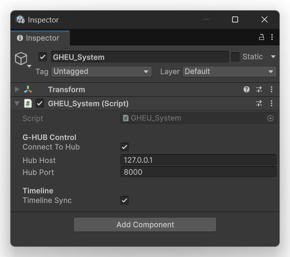

## G-HUB Control

### Connect To Hub

이 System의 G-HUB Connection Workflow를 활성화합니다.

### Hub Host

기본값:

```text
127.0.0.1
```

일반적인 GHEU Workflow는 동일한 Windows PC에서 Local Communication을 사용하는 것을 전제로 합니다.

### Hub Port

기본값:

```text
8000
```

GHEU Hub Port는 G-HUB Control Port와 일치해야 합니다.

---

## Timeline

### Timeline Sync

G-HUB Canonical Timeline Synchronization System 참여를 활성화합니다.

이 설정은 GHEU Control Window에서도 사용할 수 있습니다.

---

# GHEU_Avatar

`GHEU_Avatar`는 Unity Character에 Attach하는 주요 Body Synchronization Component입니다.

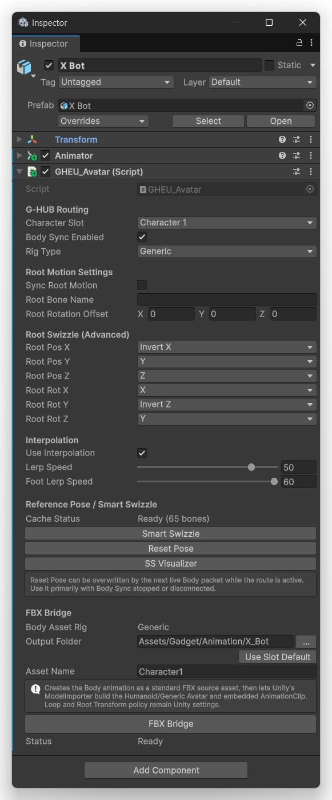

---

## G-HUB Routing

### Character Slot

Character를 다음 G-HUB Character Slot 중 하나에 할당합니다.

- Character 1
- Character 2
- Character 3
- Character 4
- Character 5

대응하는 Cascadeur Character도 동일한 Character Slot을 사용해야 합니다.

GHEU v1.0.1은 현재 URSS Explicit Character Routing Contract를 따릅니다.

| GHEU Character Slot | URSS Route |
| --- | --- |
| Character 1 | `char_01` |
| Character 2 | `char_02` |
| Character 3 | `char_03` |
| Character 4 | `char_04` |
| Character 5 | `char_05` |

Character Identity는 할당된 URSS Route / Slot에서 결정됩니다. Bone Request는 원래 Joint Name을 사용하며 Legacy `character1:`, `character2:` 등의 Prefix가 필요하지 않습니다.

### Body Sync Enabled

이 Character의 Body Synchronization을 활성화하거나 비활성화합니다.

### Rig Type

지원 값:

- **Humanoid**
- **Generic**

둘 다 GHEU v1.0.1에서 공식 지원합니다.

### Local Position Scale

`Local Position Scale`은 Root Motion 및 Translation-enabled Bone에 GHEU가 사용하는 Position Conversion Factor를 노출합니다.

기본값:

```text
0.01
```

이 기본값은 이전 GHEU Release에서 사용하던 Centimeter-to-meter Conversion을 그대로 유지합니다.

예:

- `0.01` — 표준 기본 동작
- `0.005` — 기본 Translation의 절반
- `0.02` — 기본 Translation의 두 배

Live Body Synchronization과 Offline Body Animation Processing 모두 동일한 값을 사용하므로 Live Motion과 Baked Output이 일관된 Scale을 유지합니다.

이 설정은 Rotation에는 적용되지 않습니다.

> Destination Character에 별도의 Position Conversion이 필요하지 않다면 `Local Position Scale`은 `0.01`로 유지하십시오.

---

# Root Motion Settings

Root Motion Synchronization은 선택 사항입니다.

## Sync Root Motion

Root Bone Translation / Rotation Synchronization을 활성화합니다.

비활성화하면 설정된 Root-motion Path를 적용하지 않고 Mapped Body Pose만 동기화합니다.

## Root Bone Name

Root Motion Synchronization이 활성화된 경우 Character가 사용하는 Root Bone을 입력합니다.

## Root Rotation Offset

Unity Character의 Root Orientation이 Source Coordinate System과 다를 때 Rotation Offset을 적용합니다.

Model Import Orientation과 Cascadeur Root Orientation이 직접 일치하지 않을 때 유용합니다.

---

# Root Swizzle (Advanced)

Root Swizzle은 Root Translation / Rotation Axis를 재매핑합니다.

사용 가능한 Control:

- Root Pos X
- Root Pos Y
- Root Pos Z
- Root Rot X
- Root Rot Y
- Root Rot Z

Imported Coordinate System과 Root Hierarchy에 따라 Character별로 다른 Mapping이 필요할 수 있습니다.

> Root Swizzle은 Advanced Adjustment입니다. Root Translation / Rotation이 잘못 동작하는 경우가 아니라면 변경하지 마십시오.

---

# Interpolation

Incoming Body Motion은 Interpolation을 사용해 Smoothing할 수 있습니다.

## Use Interpolation

Body Interpolation을 활성화합니다.

## Lerp Speed

General Body Interpolation Speed를 제어합니다.

## Foot Lerp Speed

Foot Interpolation을 별도로 제어합니다.

이를 통해 Foot Response를 나머지 Character와 독립적으로 조정할 수 있습니다.

---

# Reference Pose / Smart Swizzle

GHEU는 Rig-Agnostic Body Synchronization을 위해 Cached Reference-pose Workflow를 사용합니다.

Character Route가 처음 Active가 되면 GHEU는 현재 Unity Reference Pose를 Capture하고 대응하는 Cascadeur Reference-pose Data를 요청합니다.

생성된 Cache는 이후 호환되는 Connection에서 재사용할 수 있습니다.

## Cache Status

예:

```text
Missing
Ready (65 bones)
Ready (100 bones)
```

`Ready`는 Mapped Character에 Reference Cache가 사용 가능함을 의미합니다.

## Smart Swizzle

필요한 경우 Smart Swizzle Reference Process를 시작하거나 갱신합니다.

## Reset Pose

Cached Reference Pose를 복원합니다.

> Body Route가 Active인 동안에는 다음 Incoming Live Body Packet이 Reset Pose 결과를 덮어쓸 수 있습니다. 주로 Body Sync가 중지 또는 연결 해제된 상태에서 사용하십시오.

## SS Visualizer

선택한 Character의 Smart Swizzle Diagnostic Visualizer를 엽니다.

---

# Smart Swizzle Visualizer

**SS Visualizer**는 Reference-pose 및 Mapping Pipeline을 검사하기 위한 Diagnostic Tool입니다.

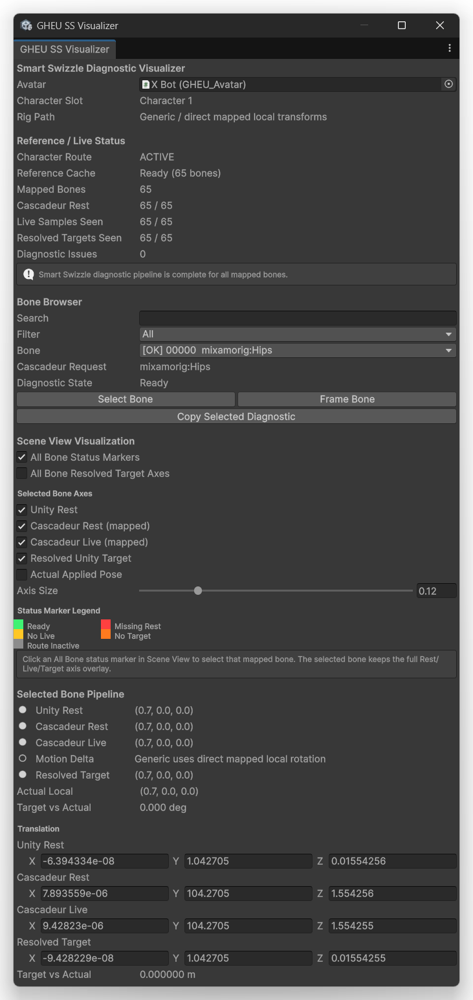

주 용도:

- 정상적으로 동기화되지 않는 Rig 진단
- Reference-pose Pipeline 완료 여부 확인
- Bone별 Mapping 확인
- Orientation / Axis 차이 확인
- 누락된 Rest, Live, Target Data 식별

Character가 정상적으로 동작하기 시작한 뒤에는 일반 Synchronization에 SS Visualizer가 필요하지 않습니다.

---

## Reference / Live Status

Status 영역에는 다음이 포함됩니다.

### Character Route

선택한 Character Route가 Active인지 표시합니다.

### Reference Cache

현재 Cached Reference-pose State를 표시합니다.

### Mapped Bones

현재 Mapping된 Bone 수입니다.

### Cascadeur Rest

Cascadeur Reference-pose Data를 받은 Mapped Bone 수를 표시합니다.

### Live Samples Seen

Live Body Sample을 받은 Mapped Bone 수를 표시합니다.

### Resolved Targets Seen

Resolve된 Unity Target Bone 수를 표시합니다.

### Diagnostic Issues

감지된 Smart Swizzle Diagnostic Issue 수를 표시합니다.

전체 Pipeline이 사용 가능하면 Visualizer는 모든 Mapped Bone에 대해 Diagnostic Pipeline이 완료되었음을 표시합니다.

---

## Bone Browser

Bone Browser 제공 기능:

- Search
- Filter
- Bone Selection
- Cascadeur Request Name
- Diagnostic State
- Select Bone
- Frame Bone
- Copy Selected Diagnostic

문제가 있는 Bone을 개별적으로 검사할 수 있습니다.

---

## Scene View Visualization

Visualizer는 Unity Scene View에 Diagnostic Marker와 Axis를 직접 표시할 수 있습니다.

옵션:

- All Bone Status Markers
- All Bone Resolved Target Axes

선택 Bone에 대해 다음을 표시할 수 있습니다.

- Unity Rest
- Cascadeur Rest (mapped)
- Cascadeur Live (mapped)
- Resolved Unity Target
- Actual Applied Pose

Axis Size는 Scene View Visualization Scale을 제어합니다.

---

## Status Marker Legend

Marker Color는 다음과 같은 상태를 나타냅니다.

- Ready
- No Live
- Route Inactive
- Missing Rest
- No Target

이 Marker를 사용해 Synchronization Pipeline에서 불완전한 부분을 빠르게 찾을 수 있습니다.

---

## Selected Bone Pipeline

선택 Bone에 대해 Visualizer는 다음을 표시할 수 있습니다.

- Unity Rest
- Cascadeur Rest
- Cascadeur Live
- Motion Delta / Mapping Mode
- Resolved Target
- Actual Local
- Target vs Actual

더 자세한 진단을 위해 Translation / Orientation Value도 숫자로 표시됩니다.

---

# Rig-Agnostic Synchronization

GHEU는 호환되는 Character Structure에서 사용자가 직접 Bone Mapping을 작성하지 않아도 되도록 설계되었습니다.

Character Structure 및 Reference-pose 정보는 G-HUB Connection Workflow를 통해 교환되며, GHEU가 Unity 측 Target Mapping을 내부적으로 해결합니다.

동일한 Architecture가 공식 지원되는 두 Rig Type에 모두 사용됩니다.

- Humanoid
- Generic

따라서 일반적인 Humanoid뿐 아니라 Non-humanoid Bone-driven Character도 지원할 수 있습니다.

실제 호환성은 연결된 양쪽 애플리케이션에서 제공되는 Hierarchy 및 Transform Data에 따라 달라집니다.

---

# Humanoid Workflow

Humanoid는 공식 지원됩니다.

권장 설정:

1. `Rig Type`을 **Humanoid**로 설정합니다.
2. Unity Model에 유효한 Humanoid Avatar가 있는지 확인합니다.
3. Body Sync를 활성화합니다.
4. 필요한 경우에만 Root Motion을 설정합니다.
5. 대응하는 GHEC Character Slot을 연결합니다.
6. 결과가 올바르지 않다면 Smart Swizzle Diagnostic을 사용합니다.
7. Offline Body Animation Transfer에는 FBX Bridge를 사용합니다.

GHEU는 결과 Humanoid Animation Asset을 준비할 때 Unity ModelImporter Workflow를 사용합니다.

---

# Generic Workflow

Generic은 공식 지원됩니다.

권장 설정:

1. `Rig Type`을 **Generic**으로 설정합니다.
2. Body Sync를 활성화합니다.
3. Character에 필요한 경우에만 Root Motion / Root Swizzle을 설정합니다.
4. 대응하는 GHEC Character Slot을 연결합니다.
5. Orientation 또는 Reference-pose 문제 진단에는 SS Visualizer를 사용합니다.
6. Offline Body Animation Transfer에는 FBX Bridge를 사용합니다.

Generic 지원은 Humanoid 형태의 Character에만 제한되지 않습니다.

Character Structure가 Source Character와 호환된다면 Non-humanoid Rig도 동기화할 수 있습니다.

---

# FBX Bridge

FBX Bridge는 Body Animation을 표준 FBX Source Asset으로 생성한 뒤, Unity ModelImporter가 Humanoid 또는 Generic Avatar와 Embedded AnimationClip을 생성할 수 있도록 합니다.

`GHEU_Avatar`의 주요 Control:

- Body Asset Rig
- Output Folder
- Use Slot Default
- Asset Name
- FBX Bridge
- Status

---

## Body Asset Rig

선택된 Body Asset Rig Mode를 표시합니다.

- Humanoid
- Generic

현재 Active GHEU Character Workflow를 따릅니다.

## Output Folder

생성된 Body Animation Asset이 저장될 위치를 지정합니다.

`...` 버튼으로 Unity Project Folder를 선택합니다.

## Use Slot Default

현재 Character Slot과 연결된 기본 Output Folder로 복원합니다.

## Asset Name

생성되는 Animation Asset 이름을 설정합니다.

## FBX Bridge

Animation Transfer / Import Workflow를 시작합니다.

Export 전에 Character Route가 Active 상태여야 합니다.

## Status

FBX Bridge 상태와 마지막 완료 Export 정보를 표시합니다.

> Animation Clip Loop 및 Root Transform Policy는 Import 이후 Unity 설정으로 유지됩니다.

---

# GHEU_ShapeKeys

`GHEU_ShapeKeys`는 Facial / BlendShape Synchronization을 활성화합니다.

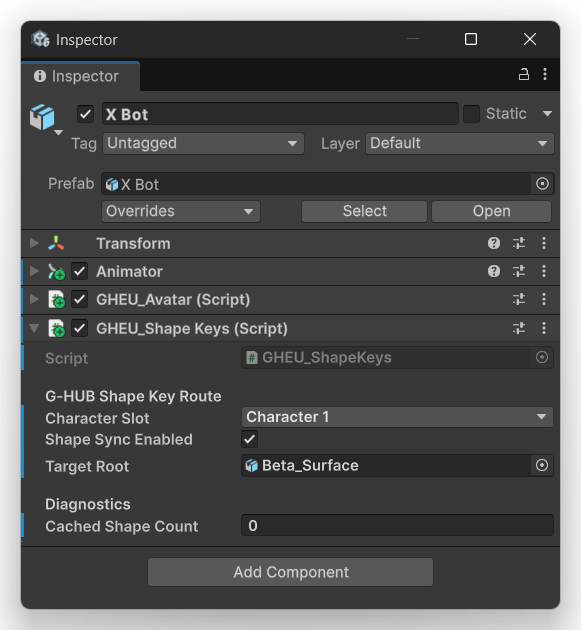

---

## G-HUB Shape Key Route

### Character Slot

Facial Synchronization을 G-HUB Character Slot 중 하나에 할당합니다.

Facial Character Slot은 대상 Character와 일치해야 합니다.

### Shape Sync Enabled

Facial / BlendShape Synchronization을 활성화하거나 비활성화합니다.

### Target Root

Character의 Facial / BlendShape Route에 사용되는 Target Object Hierarchy를 지정합니다.

---

## Diagnostics

### Cached Shape Count

Target Character에 대해 GHEU가 현재 Cache하고 있는 Shape Key 수를 표시합니다.

---

# Timeline Setup

GHEU는 Unity `PlayableDirector`와 함께 `GHEU_Timeline` Scene Object를 사용합니다.

Timeline 예:

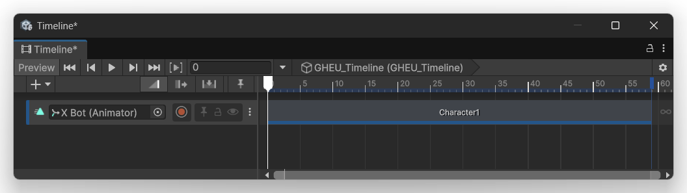

일반적인 Timeline Track에는 Body FBX Bridge가 생성한 Animation Clip을 배치할 수 있습니다.

---

# GHEU_Timeline

`GHEU_Timeline`에는 Bake 설정과 Multi-character Facial Bake Control이 포함됩니다.

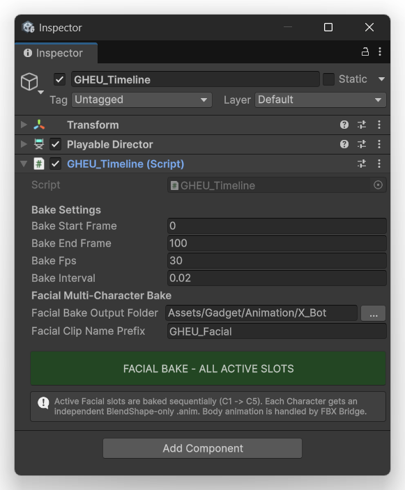

---

## Bake Settings

### Bake Start Frame

Facial Bake에 포함되는 첫 Frame입니다.

### Bake End Frame

Facial Bake에 포함되는 마지막 Frame입니다.

### Bake Fps

생성되는 Facial `AnimationClip`의 Destination / Output Frame Rate입니다.

SE Source Timeline은 다른 Frame Rate를 사용할 수 있습니다. GHEU Offline Facial Bake는 Source / Destination Frame Number가 동일하다고 가정하지 않고 Canonical Time을 기준으로 동기화합니다.

예:

```text
Unity Bake Output: 24 FPS
SE Timeline:       60 FPS

Unity 24F = 1.0 second
SE    60F = 1.0 second
```

### Bake Interval

Bake Process에서 사용하는 Sampling Interval입니다.

---

# Facial Multi-Character Bake

## Facial Bake Output Folder

생성되는 Facial Animation Clip의 Destination Folder입니다.

`...` 버튼으로 Output Folder를 선택합니다.

## Facial Clip Name Prefix

생성되는 Facial Animation Clip Name에 사용할 Prefix입니다.

## FACIAL BAKE - ALL ACTIVE SLOTS

모든 Active Facial Character Slot에 대해 Facial Bake를 시작합니다.

동작 규칙:

- Active Facial Character Slot만 Bake합니다.
- Slot은 **C1부터 C5까지** 순차적으로 처리합니다.
- 각 Character는 독립적인 **BlendShape-only AnimationClip**을 받습니다.
- Incoming Bake Stream에 존재하는 Shape Key만 포함됩니다.
- Body Animation은 **FBX Bridge**에서 별도로 처리합니다.
- Source / Output FPS가 달라도 되며 Bake 중 Canonical Time이 유지됩니다.

이 분리 구조를 통해 Body와 Facial Animation Asset을 독립적으로 유지합니다.

---

# Canonical Timeline Synchronization

GHEU는 G-HUB Canonical Timeline System에 참여할 수 있습니다.

Timeline Synchronization에 포함될 수 있는 항목:

- Current Frame
- Play
- Pause
- Stop
- Scrub / Seek
- Timeline Range
- Frame Rate

Timeline Sync는 다음에서 제어할 수 있습니다.

- `GHEU_System`
- GHEU Control Window

---

# Animator Interaction

Unity `Animator`와 GHEU가 동일한 Character Transform에 동시에 값을 쓰려고 할 수 있습니다.

Live Synchronization 중 Character가 떨리거나 Incoming Pose와 충돌하거나 안정적으로 유지되지 않는다면 Animator도 같은 Bone을 제어하고 있는지 확인하십시오.

Live Synchronization에서는 Workflow에 맞게 충돌하는 Animation Ownership을 제거하거나 비활성화하십시오.

---

# Character Structure Requirements

GHEU의 Rig-agnostic Workflow는 일반적인 User-authored Bone Mapping을 제거하지만, Source와 Destination Character Structure는 여전히 호환되어야 합니다.

직접 대응이 필요한 곳에서는 일치하는 Hierarchy와 Bone Naming이 중요합니다.

GHEU는 16-bit Bone ID를 사용합니다.

현재 GHEU v1.0.1 Transport는 Single-datagram UDP Payload Limit로 인해 동기화되는 Character 하나당 최대 **2,112 Bone Entry**를 지원합니다.

내부 Bone ID 및 Bone-count Field는 16-bit 값을 사용하지만 v1.0.1에서는 Packet Splitting이 구현되어 있지 않습니다.

---

# 문제 해결

## GHEU가 G-HUB에 연결되지 않는 경우

다음을 확인하십시오.

- G-HUB가 실행 중인지
- `Hub Host`가 올바른지
- GHEU와 G-HUB가 동일한 Control Port를 사용하는지
- 대상 `GHEU_System`이 선택되어 있는지
- Windows Firewall 또는 보안 소프트웨어가 Local Communication을 차단하지 않는지

---

## Body Route가 OFF 상태로 유지되는 경우

다음을 확인하십시오.

- `GHEU_Avatar`가 대상 Character에 Attach되어 있는지
- 올바른 Character Slot이 선택되어 있는지
- **Body Sync Enabled**가 활성화되어 있는지
- GHEC가 연결되어 있는지
- 대응하는 Cascadeur Character Slot이 선택되어 있는지
- G-HUB에 Route가 존재하는지

---

## Face Route가 OFF 상태로 유지되는 경우

다음을 확인하십시오.

- `GHEU_ShapeKeys`가 Attach되어 있는지
- 올바른 Character Slot이 선택되어 있는지
- **Shape Sync Enabled**가 활성화되어 있는지
- Target Root가 올바른지
- Facial Source가 Active인지
- 대응하는 G-HUB Route가 존재하는지

---

## Synchronization 중 Character가 떨리는 경우

다음을 확인하십시오.

- Animator가 동일한 Transform에 값을 쓰고 있는지
- 다른 Animation System이 Character를 제어하고 있는지
- Interpolation 설정이 적절한지

---

## Smart Swizzle Cache가 Missing으로 표시되는 경우

Unity Character가 의도한 Reference Pose에 있는 상태에서 Character Route를 연결하십시오.

그래도 Cache가 Ready가 되지 않는다면:

1. **SS Visualizer**를 엽니다.
2. Character Route를 확인합니다.
3. Cascadeur Rest Coverage를 확인합니다.
4. Live Samples Seen을 확인합니다.
5. Resolved Targets Seen을 확인합니다.
6. Diagnostic Issues를 확인합니다.

---

## Generic Character Orientation이 잘못된 경우

다음을 확인하십시오.

- Root Rotation Offset
- Root Swizzle
- Root Hierarchy
- SS Visualizer Bone별 Diagnostic

---

## FBX Bridge를 실행할 수 없는 경우

다음을 확인하십시오.

- G-HUB가 연결되어 있는지
- Character Route가 Active인지
- Output Folder가 유효한지
- Rig Type이 Character와 일치하는지
- Asset Name이 유효한지

---

## Facial Bake Button이 비활성화된 경우

다음을 확인하십시오.

- G-HUB가 연결되어 있는지
- 최소 하나의 Facial Route가 Active인지
- 대상 Character에서 `GHEU_ShapeKeys`가 활성화되어 있는지
- 대상 Timeline이 선택되어 있는지

---

# Open Source

Unity 측 GHEU Source Code는 Open Source로 공개됩니다.

적용 License는 GHEU Release에 포함되어 있습니다.

---

# Third-Party Notice

GHEU는 Unity와 함께 사용하도록 설계된 독립적인 **TeamGadget** 프로젝트입니다.

TeamGadget은 Unity Technologies 또는 Unity의 개발자 / 소유자와 제휴, 승인, 후원, 인증 또는 공식 지원 관계에 있지 않습니다.

Unity 및 관련 Product Name과 Trademark는 각 권리자에게 귀속됩니다.

GHEU는 TeamGadget G-HUB Architecture를 통해서만 다른 Third-party Application과 상호 운용됩니다. Third-party Product에 대한 언급은 호환성 및 상호 운용성 식별만을 위한 것입니다.

---

# Project

**TeamGadget**  
**GHEU — G-HUB Entangle for Unity v1.0.1**
