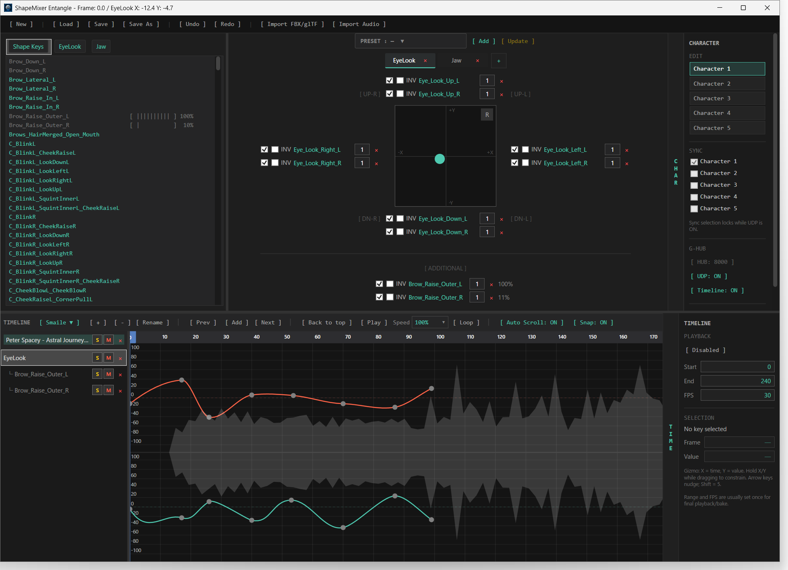
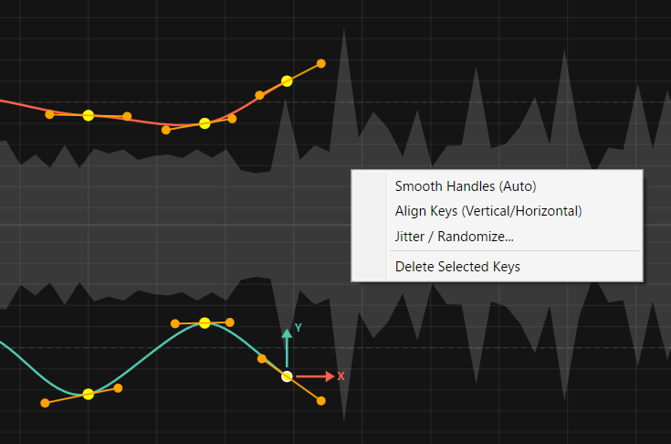

# ShapeMixer Entangle v1.0

**Facial / Shape Key Authoring Endpoint**

**ShapeMixer Entangle (SE)**는 **G-HUB**를 통해 동작하도록 설계된 독립적인 TeamGadget Facial Animation / Shape Key Authoring Tool입니다.

SE는 FBX 또는 glTF Asset에서 Shape Key / Morph Target을 Import하고, Layered XY-pad Mixing, Preset, Bezier Timeline Editor, Reference Audio Playback, Multi-character Routing, 호환되는 TeamGadget Endpoint로의 실시간 Shape Key Publishing을 제공합니다.

또한 **GHEU Offline Facial Bake** Workflow의 Facial Animation Source 역할도 합니다.

> SE는 Editing과 Live Routing을 분리합니다. 하나의 Character Slot을 편집하면서, 어떤 Character Slot이 G-HUB Synchronization에 참여할지는 별도로 선택할 수 있습니다.

---

## 개요

SE는 **TeamGadget Universal Real-Time Sync System**의 Facial Animation Authoring Endpoint입니다.

SE는 Unity, Blender, Cascadeur 또는 기타 애플리케이션과 **직접 통신하지 않습니다**.  
Live Shape Key Data, Timeline State, Route Ownership, Offline Bake Request는 모두 **G-HUB**를 통해 처리됩니다.

```text
ShapeMixer Entangle / SE
          │
          ▼
        G-HUB
          │
          ├── GHEU — G-HUB Entangle for Unity
          └── GHEB — G-HUB Entangle for Blender
```

SE는 최대 **5 Character Slots**을 지원합니다.

각 Character Slot은 독립적으로 다음 데이터를 가집니다.

- Imported Shape Key Set
- XY-pad Layer
- Additional Shape Key Assignment
- Preset
- Timeline Track
- Graph-editor State
- G-HUB Facial Route



---

## 기능

- G-HUB를 통한 실시간 Shape Key / BlendShape Publishing
- 최대 **5 Character Slots**
- 독립적인 **EDIT** / **SYNC** Character 선택
- FBX / glTF Shape Key Import
- Layered XY-pad Facial Mixing
- Directional Shape Key Assignment
- Additional Shape Key Control
- Assignment별 Enable / Inversion / Multiplier Control
- Preset 생성 및 Update
- Multi-take Animation Workflow
- Bezier Animation Curve Editor
- Timeline Playback, Looping, Range, FPS, Snapping, Auto-scroll Control
- WAV / MP3 Reference Audio Import
- Audio Waveform 표시
- Audio Offset, Mute, Solo, Volume Control
- Undo / Redo
- `.sme` Project Save / Load
- Canonical G-HUB Timeline Synchronization
- GHEU Offline Facial Bake Request에 자동 응답
- 일반 Timeline / Editing 작업용 Keyboard Shortcut

---

## 시스템 요구 사항

- **Windows 64-bit**
- **G-HUB v1.0**
- Live Facial Synchronization용 호환 TeamGadget Destination Endpoint
- Unity Offline Facial Bake 사용 시: **GHEU v1.0**

SE v1.0은 빌드된 Windows Application으로 배포됩니다.

별도 Installer는 필요하지 않습니다.

---

## 배포

SE v1.0은 Portable ZIP Archive로 배포됩니다.

```text
ShapeMixer_Entangle_v1.0_Windows_x64.zip
```

Release ZIP에는 적용되는 TeamGadget License가 포함됩니다. Archive를 쓰기 가능한 Folder에 압축 해제하고 포함된 모든 File을 함께 유지하십시오.

SE Source Code는 Public Binary Distribution에 포함되지 않습니다.

---

# 설치

1. 다음 파일을 다운로드합니다.

```text
ShapeMixer_Entangle_v1.0_Windows_x64.zip
```

2. ZIP Archive를 압축 해제합니다.

3. 다음 파일을 실행합니다.

```text
ShapeMixerEntangle.exe
```

4. Live Shape Key Output 또는 Timeline Sync를 활성화하기 전에 **G-HUB**를 실행합니다.

---

# 빠른 시작

1. **G-HUB**를 실행합니다.
2. **ShapeMixer Entangle**을 실행합니다.
3. Shape Key / Morph Target이 포함된 FBX 또는 glTF Character Asset을 Import합니다.
4. **EDIT** Panel에서 편집할 Character Slot을 선택합니다.
5. Shape Key List에서 Shape Key를 **Right-drag**하여 필요한 XY-pad Direction, **ADDITIONAL**, 또는 Timeline에 Drop합니다.
6. 필요한 Animation Key 또는 Preset을 만듭니다.
7. **SYNC** Panel에서 대상 Character Slot을 활성화합니다.
8. **UDP: OFF**를 눌러 Live Shape Key Publishing을 **ON**으로 변경합니다.
9. Destination TeamGadget Endpoint에서 동일한 Character Slot을 연결합니다.
10. Canonical Timeline Synchronization이 필요하면 **Timeline: ON**을 활성화합니다.

> UDP Publishing이 Active인 동안 SYNC 선택은 잠깁니다. Live Synchronization에 참여하는 Character Slot을 변경하려면 먼저 UDP를 OFF로 변경하십시오.

---

# Main Window

SE Interface는 네 가지 주요 작업 영역으로 구성됩니다.

- 왼쪽: Shape Key List 및 Tab
- 중앙: Pad / Preset Authoring Area
- 오른쪽: Character, G-HUB, Timeline Control
- 하단: Timeline 및 Bezier Curve Editor

현재 Facial Control, Animation Curve, Audio Waveform, G-HUB State를 한 화면에서 함께 볼 수 있도록 설계되었습니다.

---

# Character Slots

SE는 다음 Character Slot을 지원합니다.

```text
Character 1
Character 2
Character 3
Character 4
Character 5
```

각 Character Slot은 독립적인 Facial Authoring Data와 독립적인 G-HUB Facial Route를 가집니다.

## EDIT

**EDIT** Selection은 현재 편집 중인 Character Slot을 선택합니다.

EDIT Character를 변경하는 것만으로 Live Synchronization이 활성화되거나 비활성화되지는 않습니다.

## SYNC

**SYNC** Selection은 어떤 Character Slot이 G-HUB Shape Key Routing에 참여할지 선택합니다.

여러 Character Slot을 동시에 Synchronization 대상으로 활성화할 수 있습니다.

새 Project에서는 Character 1이 기본적으로 참여합니다. 필요에 따라 Character 2–5를 활성화할 수 있습니다.

UDP Publishing이 ON인 동안에는 Active Transmission 중 Route Configuration이 변경되는 것을 막기 위해 SYNC 선택이 잠깁니다.

---

# G-HUB Connection

오른쪽 G-HUB Control에는 다음 항목이 있습니다.

```text
[ HUB: 8000 ]
[ UDP: OFF ]
[ Timeline: OFF ]
```

## Control Port

기본값:

```text
8000
```

SE Control Port는 G-HUB Control Port와 일치해야 합니다.

SE는 G-HUB Control Port만 필요합니다.  
Live UDP Data Port는 G-HUB가 자동으로 할당합니다.

일반적인 사용은 동일한 Windows PC에서의 Local Communication을 전제로 합니다.

## UDP

`UDP: ON`은 선택한 SYNC Character Slot의 Live Shape Key Publishing을 활성화합니다.

호환 Destination Endpoint가 동일한 Character Slot로 연결되면 G-HUB가 Facial Route를 생성하고 필요한 Data Channel을 자동 할당합니다.

## Timeline

`Timeline: ON`은 G-HUB Canonical Timeline System 참여를 활성화합니다.

Timeline Sync는 Live Shape Key UDP Publishing과 독립적입니다.

---

# Shape Key Import

다음을 사용합니다.

```text
[ Import FBX/glTF ]
```

지원되는 FBX 또는 glTF Asset에서 Shape Key / Morph-target Name을 불러옵니다.

SE는 Imported Shape Key Structure를 Facial Authoring 및 G-HUB Output에 사용합니다.

Model을 Import해도 SE 내부에 3D Preview는 생성되지 않습니다.  
Imported Asset은 Shape Key Structure Source로 사용됩니다.

유효한 Shape Key를 찾지 못한 경우 현재 Shape Key Setup을 빈 상태로 덮어쓰지 않고 유지합니다.

---

# Shape Key Controls

Shape Key List에는 Active Character Slot의 사용 가능한 Imported Facial Target이 표시됩니다.

Shape Key는 주로 세 가지 방식으로 사용할 수 있습니다.

- XY-pad Direction에 Assignment
- **ADDITIONAL** 영역에 Assignment
- Timeline에서 직접 Animation

Shape Key Value는 함께 평가되어 최종 Facial State를 생성합니다.

## Shape Key Assignment

Shape Key Assignment는 Shape Key List에서 **Right Mouse Drag-and-drop**으로 생성합니다.

기본 Workflow:

1. **EDIT** Panel에서 편집할 Character Slot을 선택합니다.
2. SE 왼쪽 List에서 필요한 Shape Key를 찾습니다.
3. **오른쪽 Mouse Button**을 누른 채 Shape Key Name을 Drag합니다.
4. 원하는 Destination에 Drop합니다.
   - XY-pad Direction
   - **ADDITIONAL** Area
   - Direct Shape Key Animation용 Timeline Area

> Shape Key Assignment는 일반 Left-button Drag가 아니라 **Right-drag**를 사용합니다.

Assignment는 현재 Active **EDIT** Character Slot에 속합니다. 각 Character Slot은 자신의 Authoring Data를 유지하므로 Control 또는 Timeline Track을 Assign하기 전에 대상 EDIT Character를 확인하십시오.

Shape Key를 Authoring Control에 Assign하는 것만으로 Live Output이 활성화되지는 않습니다. Live Routing은 **SYNC** Character Selection 및 `UDP: ON`에서 별도로 제어합니다.

XY-pad Assignment의 경우 여러 Shape Key를 같은 Direction에 배치할 수 있습니다. 각 Assignment는 Enable, INV, Multiplier Control을 개별적으로 조절할 수 있습니다.

---

# XY Pad

SE는 Expression Control에 Layered XY Pad를 사용합니다.

Pad에는 다음 Zone에 Shape Key를 Assign할 수 있습니다.

```text
UP
DOWN
LEFT
RIGHT
UP-LEFT
UP-RIGHT
DOWN-LEFT
DOWN-RIGHT
ADDITIONAL
```

Shape Key List에서 Shape Key를 **Right-drag**하여 필요한 Zone에 Drop합니다.

같은 Direction에 여러 Shape Key를 Assign할 수 있습니다.

Pad는 Puck Position과 Assignment Setting에 따라 배치된 Shape Key를 혼합합니다.

**XY Pad 자체도 Timeline에 Assign할 수 있습니다**. Mouse를 XY Control Area 위에 놓은 뒤 **XY Area를 Right-drag하여 Timeline에 Drop**하십시오.

이렇게 하면 Active **EDIT** Character Context용 XY-pad Animation Track이 생성됩니다. Pad Movement를 시간에 따라 Keying하고, 해당 Child Curve를 Bezier Curve Editor에서 세밀하게 조정할 수 있습니다.

---

## Assignment Controls

각 Assignment에는 다음과 같은 Control이 표시될 수 있습니다.

- Enable
- INV
- Multiplier
- Current Value

이를 통해 하나의 Pad Direction이 서로 다른 Response Direction / Strength로 여러 Facial Target을 Drive할 수 있습니다.

---

# Pad Layers

여러 Pad Layer를 생성할 수 있습니다.

각 Layer는 다음과 같은 Facial Control Group을 표현할 수 있습니다.

```text
EYE
BROW
MOUTH
CUSTOM
```

Layer Name은 자유롭게 변경할 수 있습니다.

이를 통해 큰 Facial Rig를 작은 Control Group으로 나누어 관리할 수 있습니다.

---

# Presets

SE는 현재 Pad Configuration용 Preset을 지원합니다.

Preset Control을 사용하여 다음을 수행할 수 있습니다.

- Preset 생성
- Preset 적용
- 기존 Preset Update
- 사용 가능한 Preset Control을 이용한 Rename / Remove

Preset은 빠른 Recall을 위해 Authoring된 Facial Control State를 저장합니다.

---

# Timeline

하단 영역에는 SE Animation Timeline 및 Bezier Curve Editor가 있습니다.

Timeline 지원 기능:

- Multiple Takes
- Shape Key Track
- XY-pad Track
- Audio Track
- Previous / Add / Next Key Navigation
- Play / Pause
- Playback Speed
- Loop Playback
- Auto-scroll
- Snap
- Playback Range
- 설정 가능한 FPS
- Graph-track Selection
- Timeline Head Context Menu를 통한 Preset Stamping

현재 Facial Result는 Timeline과 Active Character Slot의 Authoring Data에서 평가됩니다.

Timeline Area는 주요 Animation Workspace로 설계되었습니다. 현재 Character Slot을 벗어나지 않고 Take 전환, Edit Track 선택, Waveform Timing Preview, Key Navigation, Graph Editing 작업을 수행할 수 있습니다.

## Control을 Timeline에 Assign

SE는 Individual Shape Key와 전체 XY Pad 모두 Direct Timeline Assignment를 지원합니다.

### Shape Key Track

Shape Key를 직접 Animation하려면 왼쪽 List에서 Shape Key를 **Right-drag**하여 Timeline Area에 Drop합니다.

Active **EDIT** Character Context용 Direct Shape Key Animation Track이 생성됩니다. Timeline에서 Keying한 뒤 Bezier Curve Editor에서 다듬을 수 있습니다.

XY-pad Direction 또는 **ADDITIONAL** Control을 거치지 않고 Individual Facial Target을 직접 Animation하고 싶을 때 사용합니다.

### XY-Pad Track

XY Pad를 Control로 Animation하려면 Mouse를 **XY Control Area 자체** 위에 놓고 **XY Area를 Right-drag하여 Timeline에 Drop**합니다.

Active **EDIT** Character Context용 XY-pad Animation Track이 생성됩니다. Pad X/Y Motion을 시간에 따라 Animation할 수 있으며 Pad에 Assign된 모든 Shape Key가 함께 Authoring된 Pad Movement를 따릅니다.

생성된 XY-pad Curve는 다른 Timeline Animation Data와 동일하게 Bezier Curve Editor에서 다듬을 수 있습니다.

> Timeline Assignment도 **Right-drag**를 사용합니다. XY Pad를 Drag한다는 것은 Pad 주변의 Individual Shape Key Assignment Label이 아니라 XY Control Area 자체를 Grab한다는 의미입니다.

## Timeline Head / Ruler Operations

Timeline Head는 현재 Frame을 나타냅니다.

Timeline Control에서 다음을 수행할 수 있습니다.

- Previous Key로 이동
- 현재 Frame에 Key 추가
- Next Key로 이동
- Play / Pause
- Loop Playback On / Off
- Playback Speed 변경
- Auto-scroll On / Off
- Snapping On / Off
- Start / End / FPS 값 조정

또한 Timeline Head / Ruler는 **Right-click Preset Stamping**을 지원합니다.

Preset Stamping을 사용하면 Timeline Context Workflow에서 현재 Frame에 Preset Event를 직접 배치할 수 있습니다. 같은 Pose를 매번 수동으로 다시 만들지 않고 Facial State의 Blocking / Timing을 구성할 때 유용합니다.

---

# Takes

SE는 하나의 `.sme` Project 안에서 여러 Animation **Take**를 지원합니다.

다음 작업이 가능합니다.

- Take 생성
- Take 삭제
- Take Rename
- Take 전환

각 Take는 독립적인 Animation-track Data를 저장합니다.

Graph-editor Setting은 해당 Take 및 Character Context에 맞게 유지됩니다.

---

# Bezier Curve Editor

Shape Key 및 Pad Animation은 Bezier Curve로 편집할 수 있습니다.

선택한 Graph Track은 Timeline Playhead, Current Frame, Audio가 있을 경우 Reference Audio Waveform과 함께 표시됩니다.



Bezier Curve Editor는 SE의 주요 Authoring Tool 중 하나입니다.
Pad, Preset, Direct Key Placement로 Rough Performance Blocking을 만든 후, Facial Timing, Expression Shaping, Cleanup 및 세밀한 조정을 수행하도록 설계되었습니다.

## Core Editing Behavior

Graph Editor는 다음 작업을 지원합니다.

- Key Selection
- Key Dragging
- Bezier Tangent / Handle Editing
- Copy / Paste
- Delete
- Alignment 및 Curve-editing Operation
- Snapping
- Frame-range Display
- Waveform-assisted Timing Adjustment

Graph에서 Timing과 Value를 직접 편집할 수 있습니다.
Horizontal Axis는 **Time / Frame**, Vertical Axis는 **Value**를 의미합니다.
따라서 일반 Shape Key Curve뿐 아니라 XY-pad 또는 Additional Facial Control에서 생성된 Child Curve 편집에도 사용할 수 있습니다.

## Tangent Handles and Gizmo

Key를 선택하면 SE는 세밀한 Curve Editing을 위한 Bezier Handle을 표시합니다.

다음 작업이 가능합니다.

- Ease-in / Ease-out Timing 조정
- 갑작스러운 Transition을 부드럽게 처리
- Facial Accent를 더 Sharp하게 조정
- 인접 Key 사이의 Interpolation 재구성

Editor는 Working Axis를 직접 읽을 수 있도록 Local Graph-editing Gizmo도 표시합니다.

- **X** = Time
- **Y** = Value

Handle Direction / Spacing을 조정할 때 Timing, Amplitude 또는 둘 다 변경 중인지 시각적으로 명확하게 확인할 수 있습니다.

## Right-Click Key Editing Menu

Graph에서 Right-click하면 선택한 Key용 Quick Editing Operation을 사용할 수 있습니다.

현재 Context Workflow에는 다음 Command가 포함됩니다.

- **Smooth Handles (Auto)**
- **Align Keys (Vertical/Horizontal)**
- **Jitter / Randomize...**
- **Delete Selected Keys**

### Smooth Handles (Auto)

선택한 Key의 Bezier Handle을 자동으로 부드럽게 정리합니다.
Manual Editing 중 Curve가 불균일해졌을 때 빠르게 깨끗한 Interpolation으로 되돌릴 수 있습니다.

### Align Keys (Vertical/Horizontal)

Alignment Tool을 사용하면 Key Group을 쉽게 정렬할 수 있습니다.

- **Vertical Alignment** — 여러 Key를 같은 Value로 맞출 때 유용합니다.
- **Horizontal Alignment** — 여러 Key를 같은 Frame으로 맞출 때 유용합니다.

Cleanup, Rhythmic Facial Beat, Phoneme Timing, Blocking Pass에 편리합니다.

### Jitter / Randomize...

선택한 Key에 Controlled Variation을 추가합니다.
Subtle Facial Irregularity, Texture 추가 또는 지나치게 Mechanical한 반복을 깨는 데 사용할 수 있습니다.

### Delete Selected Keys

현재 Active Graph Track에서 선택한 Key를 삭제합니다.

## Timeline 및 Preset과의 관계

Graph Editor는 Timeline Workflow와 밀접하게 연결되어 있습니다.
일반적인 SE Workflow:

1. XY Pad 또는 Preset으로 Facial Pose를 Blocking합니다.
2. 해당 State를 Timeline에 Key 또는 Stamp합니다.
3. 생성된 Motion을 Bezier Curve Editor에서 다듬습니다.

Timeline Head도 **Right-click Workflow를 통한 Preset Stamping**을 지원하므로 Preset은 일회성 Pose Recall에만 제한되지 않습니다.
Timed Animation-building Element로 사용한 뒤 Graph Editor에서 Polish할 수 있습니다.

## 실제 활용 예

Bezier Curve Editor는 특히 다음 작업에 유용합니다.

- Lip / Mouth Timing Cleanup
- Brow Emphasis 및 Asymmetry Polish
- Eye Motion Shaping
- Expression 간 Transition Smoothing
- Dialogue / Music에 맞춘 Beat 조정
- GHEU Offline Facial Bake 전 Data Refinement

---

# Reference Audio

다음을 사용합니다.

```text
[ Import Audio ]
```

Reference Audio를 Import합니다.

지원 Audio File Type:

```text
WAV
MP3
```

SE는 Timeline에 Waveform을 표시하고 다음 Audio Control을 지원합니다.

- Offset
- Volume
- Mute
- Solo
- Timeline과 동기화된 Playback
- Local Scrub Preview
- 다른 G-HUB Timeline Owner를 Follow할 때 Reference Audio Playback

다른 지원 Endpoint가 Canonical Timeline을 소유할 때 SE는 Passive Timeline Follower로 유지되며 Reference Audio는 Remote Play / Pause 및 Scrub / Seek State를 따라갑니다.

Audio File은 Project에서 Reference됩니다. Source Audio File 자체는 `.sme` Project File에 Embed되지 않습니다.

Project Load 시 Referenced Audio File을 찾을 수 없어도 SE는 Audio-track 정보를 자동으로 삭제하지 않고 유지합니다.

---

# Project Files

SE Project File Extension:

```text
.sme
```

Project에는 Character Slot Data, Shape Key Setup, Pad, Preset, Take, Animation Curve, Timeline Setting, Audio-track Reference 등 Authoring State가 저장됩니다.

상단 Menu:

```text
[ New ] [ Load ] [ Save ] [ Save As ]
```

를 사용해 Project를 관리합니다.

---

# Undo / Redo

SE는 일반적인 Editing History를 제공합니다.

```text
[ Undo ]
[ Redo ]
```

Interactive Drag가 지나치게 많은 History Entry를 만들지 않도록 일반적인 Edit Operation은 하나의 User Operation으로 Grouping됩니다.

---

# Canonical Timeline Synchronization

SE는 G-HUB Canonical Timeline System에 참여할 수 있습니다.

Timeline Sync가 활성화되면 지원되는 State에는 다음이 포함될 수 있습니다.

- Current Timeline Time / Frame
- Play
- Pause
- Stop
- Scrub / Seek
- Playback Range
- Frame Rate

SE는 Active Timeline Owner가 될 수도 있고 G-HUB를 통해 받은 Timeline State를 Follow할 수도 있습니다.

SE가 다른 Endpoint를 Follow할 때 두 번째 경쟁 Timeline Clock을 실행하지 않습니다. Canonical Timeline State가 Authoritative 상태로 유지되고 Reference Audio도 수신된 Playback / Scrub State를 따라갑니다.

Timeline Synchronization은 Live Facial UDP Output과 독립적입니다.

---

# Live Facial Synchronization

Live Facial Output은 **SYNC** Panel에서 선택한 Character Slot을 사용합니다.

활성화된 각 Character Slot마다 SE는 G-HUB를 통한 독립적인 Facial Route를 유지합니다.

일반적인 Live Operation에서는 변경된 Shape Key Value만 전송하면 되며, Route Establishment / Reconnection Logic은 필요할 때 Authoritative Current State를 복원합니다.

Destination Component는 수신된 Shape Key / BlendShape 값을 대상 Character에 적용합니다.

---

# GHEU Offline Facial Bake

SE는 GHEU Offline Facial Bake Workflow에서 Facial Animation Source 역할을 합니다.

Production Workflow:

```text
ShapeMixer Entangle / SE
          │
          ▼
        G-HUB
          │
          ▼
       GHEU
          │
          ▼
BlendShape AnimationClip
```

Offline Facial Bake는 GHEU에서 시작합니다.

SE는 대응하는 Character Slot의 Routed Bake Request에 자동으로 응답하고, 요청된 Canonical Time에서 SE Timeline을 평가한 뒤 Authoring된 Shape Key Value를 G-HUB를 통해 반환합니다.

Source와 Destination Frame Rate는 같을 필요가 없습니다. GHEU가 SE Timeline FPS와 다른 Bake FPS를 사용하는 경우, SE는 Facial Animation을 평가하기 전에 요청된 Canonical Time을 대응하는 Local SE Frame으로 변환합니다.

최종 Unity 결과는 **BlendShape-only AnimationClip**입니다.

Body Animation은 GHEU의 **FBX Bridge** Workflow에서 별도로 처리합니다.

---

# Keyboard Shortcuts

| Action | Shortcut |
| --- | --- |
| Previous key | `A` |
| Add key | `S` |
| Next key | `D` |
| Delete selected keys | `Delete` |
| Clear selection | `Esc` |
| Play / Pause | `Space` |
| Save project | `Ctrl+S` |
| Copy keys | `Ctrl+C` |
| Paste keys | `Ctrl+V` |
| Undo | `Ctrl+Z` |
| Redo | `Ctrl+Y` |
| Apply selected preset | `Enter` |

---

# 문제 해결

## SE가 G-HUB에 연결되지 않는 경우

다음을 확인하십시오.

- G-HUB가 실행 중인지
- SE와 G-HUB가 동일한 Control Port를 사용하는지
- Windows Firewall 또는 보안 소프트웨어가 Local Communication을 차단하지 않는지

---

## UDP는 ON인데 Destination에 Facial Data가 도착하지 않는 경우

다음을 확인하십시오.

- 대상 Character Slot이 SE SYNC Panel에서 활성화되어 있는지
- Destination Endpoint가 G-HUB에 연결되어 있는지
- Destination이 동일한 Character Slot을 사용하는지
- G-HUB에 대응 Facial Route가 존재하는지
- Destination Endpoint에서 Shape Key Synchronization이 활성화되어 있는지

---

## Imported Model에 Shape Key가 표시되지 않는 경우

다음을 확인하십시오.

- Source Asset에 실제 Morph Target / Shape Key가 포함되어 있는지
- FBX 또는 glTF Export에 Facial Target이 포함되어 있는지
- 선택한 File이 올바른 Character Asset인지

---

## Timeline이 다른 Application을 따라가지 않는 경우

다음을 확인하십시오.

- `Timeline: ON`이 활성화되어 있는지
- 다른 Application에서도 G-HUB Timeline Sync가 활성화되어 있는지
- 두 Application이 동일한 G-HUB Instance에 연결되어 있는지

---

## Audio를 재생할 수 없는 경우

다음을 확인하십시오.

- WAV / MP3 Source File이 존재하는지
- Windows Audio Component에서 해당 File을 열 수 있는지
- Audio Track이 Mute 상태가 아닌지
- 현재 Timeline Position이 Audio Track의 Active Time Range 안에 있는지

---

# License

ShapeMixer Entangle은 TeamGadget Proprietary Software로 배포됩니다.

Binary Distribution에는 Release ZIP에 포함된 `LICENSE` File이 적용됩니다.

Third-party Software Component에는 각각의 License 조건이 계속 적용됩니다.

---

# Third-Party Notice

ShapeMixer Entangle은 **NAudio**, **Silk.NET.Assimp** 등을 포함한 Third-party Software Component를 사용합니다.

각 Component의 Copyright 및 License 조건은 계속 적용됩니다.

ShapeMixer Entangle, G-HUB, GHEU, GHEB, GHEC 및 관련 TeamGadget Product Name은 독립적인 TeamGadget Project입니다.

Third-party File Format, Application, Product 또는 Trademark에 대한 언급은 호환성 및 상호 운용성 식별만을 위한 것입니다.

모든 Third-party Product Name과 Trademark는 각 권리자에게 귀속됩니다.

---

# Project

**TeamGadget**  
**ShapeMixer Entangle v1.0**
